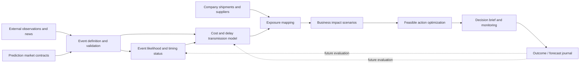

# Cost Current — Predictive Intelligence Product Reset and Codex Execution Brief

**Prepared:** October 16, 2026  
**For:** Codex working inside the existing `cost_current` repository  
**Repository:** https://github.com/Sambhav255/cost_current  
**Reviewed remote commit:** `bc20e9c67944c1d2c11b404883846f5ef6a6f780` on `main`  
**User references:** Seven screenshots of the October 16 redesign (Welcome, Overview, Forecast, What if, Decision Memo, Import, Methods).  
**Type:** Product direction + code audit + UX brief + quantitative research plan + staged implementation instructions.  
**Instruction:** **Use the actual local working tree as your source of truth**, since it may be newer than the GitHub commit reviewed here. This document supersedes the previous UI-only design brief where the directions conflict. Preserve prior work.

---

## 0. THE MOST IMPORTANT INSTRUCTION

**Do not build yet another shipment-cost dashboard. Turn Cost Current into an event-led, predictive supply-chain intelligence product that can trace an outside risk signal to a business-specific decision.**

Today's system mainly answers: “If I believe a tariff event has a 40% chance and freight disruption has a 20% chance, what would my shipment cost?”

The intended system should eventually answer:

> “What relevant disruptions could occur over the next 4–12 weeks? What does the evidence say about likelihood and timing? Which of my suppliers, shipping routes, or purchase orders are exposed? What distribution of financial and operational outcomes might follow? What alternatives are feasible, and which should I seriously consider?”

**Every primary screen should bring the user closer to that answer.** The cost calculator is the downstream decision engine, not the front door or the whole product.

### Hard rule: prediction is not a visual label

Do not claim a forecast exists simply because there is a “Forecast” button, a static probability, a series projected forward, a machine-learning library in `package.json`, or a beautiful risk heatmap. Estimates must derive from traceable inputs and a defined method; accuracy claims require honest time-ordered evaluation. Where evidence is insufficient, show _not available_ or an explicitly _illustrative simulation_. Never manufacture current events, probability values, price forecasts, backtest metrics, trading liquidity, supplier impacts, or recommendations.

### Work order

1. **Audit** the current local code and screenshot states, tests, docs, and data boundaries. Commit or protect current work; never reset it.
2. **Write a compact implementation plan** based on the exact code that exists.
3. **Implement a first real end-to-end intelligence vertical slice** within the allowed free/data constraints, preserving all existing features.
4. **Restructure UX around events → exposures → decisions**. Avoid making the dashboard look more predictive before making its behavior more predictive.
5. **Test and document** what works, what is illustrative, and what is blocked on data/model evidence.

Do not respond only with an abstract plan or a cosmetic mockup. Execute a bounded milestone, report its actual completion, and stage the rest. Do not attempt the entire commercial platform in one agent run.

---

## 1. WHY THE FOUNDER THINKS WE HAVE DRIFTED

We originally wanted a **forward-looking intelligence and decision platform** combining macroeconomic risk, geopolitics, trade-policy changes, shipping disruptions, market signals, and machine learning. The importer was supposed to benefit from the system finding threats they had _not already modeled themselves_.

Development instead optimized an honest, reliable **manual landed-cost calculator**. That work was technically responsible, but it displaced the distinctive customer job: discovering relevant possible disruptions, estimating their likelihood and consequences, and making recommendations before the business is surprised.

A good competing freight or duty calculator may be able to compute the same raw scenarios. Cost Current's hypothesis is that **connecting event intelligence to specific exposure, economics, and decisions** creates value. That hypothesis requires customer validation and empirical model tests, not claims of uniqueness.

**Revised one-sentence positioning:**

> Cost Current is a forward-looking trade and supply-chain risk intelligence system for smaller importers: it identifies emerging disruptions, connects them to a company's goods and routes, estimates possible cost/delay exposure, and helps compare practical responses.

**Three-stage product loop:**

1. **See it coming** — Signals and defined event risks, with likelihood estimates only when supportable.
2. **Know your exposure** — What products, suppliers, lanes, and dollars are affected, with timing and uncertainty.
3. **Choose the response** — Order earlier, diversify, reroute, hold buffer stock, request new quotes, or monitor; calculate total trade-offs and action constraints.

A buyer should immediately recognize the distinction between an intelligence feed and a shipment costing tool.

---

## 2. VERIFIED CURRENT CODE AUDIT (OCTOBER 16 REMOTE MAIN)

**These are claims from inspected repository source, not confirmation of behavior in every browser configuration.** The screenshots independently illustrate the shipped interface. Before implementation, reconcile this list against your local tree and any work other agents have added.

| Area                        | What is present                                                                                                                                                 | Critical limitation / next implication                                                                                                                                                                 |
| --------------------------- | --------------------------------------------------------------------------------------------------------------------------------------------------------------- | ------------------------------------------------------------------------------------------------------------------------------------------------------------------------------------------------------ |
| React application / styling | React + Vite + TypeScript; dark green aesthetic; new compact navigation; responsive components.                                                                 | Clearer visually, but the page hierarchy remains cost-first rather than event-first.                                                                                                                   |
| Portfolio overview          | `src/components/Overview.tsx` aggregates base cost and scenario exposure from `analyzeShipment`.                                                                | Its “expected extra cost” comes from user/example scenario probabilities; it is not an external risk forecast. Avoid mixing illustrative exposure with live forecast KPIs.                             |
| Cost and decision engine    | `src/lib/engine.ts` implements landed cost, four two-event outcomes, early/wait and conditional alternatives, break-even analysis.                              | Valuable downstream accounting engine. Keep it intact and tested; do not present results as predictive without supported upstream inputs.                                                              |
| Forecast page               | `src/components/Forecast.tsx`, `src/lib/forecast.ts` offer a local 28/56-day **last-observation** freight-rate baseline with strict imported-series validation. | No learned freight model, forward causal event model, interval, or automatic shock probability. Eight weekly observations are a basic intake gate, _not_ statistical sufficiency to train advanced ML. |
| Forecast vs What if         | `src/App.tsx` separates forecast and manual scenarios.                                                                                                          | Correct and must be preserved. Forecast deliberately abstains; no automatic decision ranking when relevant odds are absent.                                                                            |
| CSV and evidence            | Strict importer, `src/lib/csv.ts`, `ledger.ts`, `evidence.ts`, local storage; editable costs and source labels.                                                 | Useful; harden later for realistic product catalog and multiple lanes. Current fixture lanes are very restricted.                                                                                      |
| Globe                       | `GlobeView.tsx`, `RouteGlobe.tsx`, static city-to-city arcs and selectable routes.                                                                              | The globe displays company routes only; it does not display event geography, chokepoints, alerts, or impact propagation. Arcs are illustrative, **not** the true vessel route.                         |
| Memos                       | Manual decision memo and separate forecast evidence memo, print/export.                                                                                         | Preserve; create an _event-to-decision brief_ later, including exact evidence and as-of provenance.                                                                                                    |
| Methods                     | Shows planned econometrics, ML, probability/decision systems and external references.                                                                           | Plans are not deployed models. UI gives research plans space without making the main user workflow intelligent.                                                                                        |
| Tests                       | Unit and browser tests for inputs, cost math, forecast abstention and basic UI.                                                                                 | Extend for event contracts, exposure mapping, missing-data behavior, chronology, and mode separation.                                                                                                  |
| CI                          | Prior runs successful; most recent `bc20e9c` run was **in progress at the time checked**.                                                                       | Check the status for latest commit before claiming it passed.                                                                                                                                          |
| Vigil                       | Separate repo `Sambhav255/Vigil` contains Kalshi, Polymarket, GDELT and GPR-related code.                                                                       | Potential reusable networking ideas, **not** a production-quality probability-to-shipment mapping. Inspect again before extracting modules.                                                            |

**Source links:**

- Current README: https://github.com/Sambhav255/cost_current/blob/main/README.md
- Current shipment engine: https://github.com/Sambhav255/cost_current/blob/main/src/lib/engine.ts
- Forecast implementation: https://github.com/Sambhav255/cost_current/blob/main/src/lib/forecast.ts
- Forecast UI: https://github.com/Sambhav255/cost_current/blob/main/src/components/Forecast.tsx
- Portfolio overview: https://github.com/Sambhav255/cost_current/blob/main/src/components/Overview.tsx
- Application routing/mode: https://github.com/Sambhav255/cost_current/blob/main/src/App.tsx
- Forecast limitations: https://github.com/Sambhav255/cost_current/blob/main/docs/FORECASTS.md
- Current state tracking: https://github.com/Sambhav255/cost_current/blob/main/docs/PROGRESS.md
- CI run for reviewed commit: https://github.com/Sambhav255/cost_current/actions/runs/38861182119

### Specific shortcomings in current logic

**A. The top KPI is not really “what could happen.”** `Overview.tsx` calls `analyzeShipment` on fictional or entered shipment data and sums `addedCents`. Risk estimates are only as objective as the manual assumptions behind them. Rename or visually isolate this metric, and do not rank it beside future evidence-based forecasts as if equivalent.

**B. Freight rate ≠ a freight disruption event probability.** The simple local last-observation baseline extrapolates a rate, but cannot say “X% probability of a port closure” or “Y% probability this specific importer will pay a $3,000 surcharge.” It also cannot automatically transform a spot rate index into a specific contract invoice without basis/exposure data. Keep those targets distinct.

**C. Stacked tariff applicability is not modeled.** Duty calculations are based on user rates. HTS syntax checking is not product classification; country of origin, exclusions, special programs, trade remedies, effective dates, AD/CVD scope, and legal applicability cannot be inferred from one simplified value. Changes in ship route do not change lawful origin. Do not market this as a customs-duty determination.

**D. Market signals do not enter the application.** There is no current, exact, qualified Kalshi/Polymarket contract-to-event-to-shipment pipeline. Do not silently repurpose Vigil's title similarity or “maximum outcome price” fallback, or convert an irrelevant quote into a cost-event probability.

**E. Scenario engine assumes independent tariff/freight events.** For the current two-event demo this is clearly documented and mathematically consistent; real shocks can create dependence. Do not generalize this exact four-outcome model to a complex global supply chain with correlated port congestion, delays and rate movements.

**F. Alternatives are mostly manual.** Route or supplier changes need user-entered comparable quotes and validity checks. That is appropriate today; real product recommendations need available options, data rights and operational constraints rather than magically generated substitutes.

---

## 3. DESIGN REVIEW OF THE SEVEN SCREENSHOTS

**Overall assessment:** the redesign looks tidier, but it is still _not telling the intended story_. Colors are fine; do not spend the next sprint on branding, new gradients, bigger icons, or more CSS. Fix information architecture and data flow first.

| Screen            | What's good                                                        | What's misaligned                                                                                                                                                            | Target change                                                                                                                                                                                  |
| ----------------- | ------------------------------------------------------------------ | ---------------------------------------------------------------------------------------------------------------------------------------------------------------------------- | ---------------------------------------------------------------------------------------------------------------------------------------------------------------------------------------------- |
| **Welcome**       | Legible, confident, clean hero; globe makes the concept memorable. | “Enter shipment costs” is the lead job; there's no sign that Cost Current discovers or monitors events.                                                                      | Headline and CTA should emphasize seeing disruptions coming and understanding exposure. Let users **Explore risk intelligence** with a transparent example, then **Connect/import shipments**. |
| **Overview**      | Simplified sidebar and cards; shipment list and globe are usable.  | Leads with portfolio accounting totals, not threats. Static globe consumes prime real estate.                                                                                | Default to **Intelligence** feed + “What matters to my imports” panel. Current portfolio view becomes a second workspace, not deleted.                                                         |
| **Forecast**      | Honest unavailable state. Separates prediction from assumption.    | A large dead-end “No supported forecast” block, local JSON loading, technical metadata, and cost ledger dominate the page.                                                   | Make forecast coverage an understandable status in an event detail / lane analysis. Move importer JSON ingestion and diagnostics to **Data & methods**, not the core user journey.             |
| **What if**       | Comparisons, arithmetic, break-even graph are strong.              | Most prominent function is moving manual probability sliders; user has to invent the risk themselves. Lots of room is spent on numbers without showing the initiating event. | Keep as **Scenario Lab** launched from a specific event or shipment, with event context prefilled only from qualified evidence; manual overrides must be clear.                                |
| **Decision Memo** | Professional, portable, visually credible.                         | Describes a hypothetical shipment cost choice rather than evidence-backed disruption planning.                                                                               | Add risk brief and affected shipments when a qualified event exists; retain the existing memo for manual scenarios.                                                                            |
| **Import**        | Validations and cost inclusions are thoughtful.                    | Huge CSV detail is daunting as an entry point; seems like freight/logistics ERP.                                                                                             | Present a three-step upload process with progressive disclosure; retain full validator and template. Demo intelligence must work with fictional exposure profiles before import.               |
| **Methods**       | Transparent planned models and limitations.                        | Technical research plan is more visible than live value. This page cannot substitute for working inference.                                                                  | Keep research and provenance in a secondary trust section. Main experience should show clear evidence trails at the point of decision.                                                         |

### New navigation (avoid adding seven more primary tabs)

Prefer roughly four primary destinations:

1. **Intelligence** (default): emerging event risks and watchlist, where they might matter, time horizon, sources, freshness and unsupported status.
2. **My Exposure**: company's impacted suppliers, lanes, product groups and financial sensitivities; retains existing shipment table, import and interactive globe.
3. **Decisions**: prioritised feasible actions, comparison of expected cost vs delay, event-linked Scenario Lab, memos. Preserve the existing exact calculator.
4. **Methods & Data**: provenance, event definitions, permissions, coverage, diagnostics and advanced import tools.

A compact global importer/shipment selector stays available. Import shipment and create memo are contextual actions, not necessarily top-level destinations. Keep keyboard and mobile support. Do not remove the old features simply because their pages are moved.

### Target first screen sketch (not a mandate for rigid card layout)

```text
COST CURRENT     Intelligence | My Exposure | Decisions | Methods     As-of / data state

Supply-chain risks worth watching                               [Next 4 weeks ▾]
What could change, who is exposed, and how it might matter.

[Relevant risks: 2 illustrative] [Exposure needing review: 1] [Evidence coverage: limited]

EVENTS & SIGNALS                                   MY EXPOSED OPERATIONS
┌─────────────────────────────────────┐             ┌──────────────────────────┐
│ Tariff-policy event — China goods   │             │ Shanghai → Los Angeles │
│ Status: ILLUSTRATIVE / NOT FORECAST │             │ Home goods order        │
│ Potential duty impact: scenario ... │             │ $100k customs value     │
│ Evidence: none for real odds        │             │ View affected shipment  │
│ [See transmission] [Explore options]│             └──────────────────────────┘
├─────────────────────────────────────┤
│ Route disruption — Red Sea corridor │             [Contextual interactive globe]
│ Event geography + impacted lanes    │             Event zones + route overlays
│ Qualified odds: unavailable         │             (clearly illustrative)
│ [View context / what-if]             │
└─────────────────────────────────────┘

[Select an event to inspect causal pathway, uncertainty, and economic options]
```

The above examples are **illustrative educational cases**, not claims that these exact events are currently impending. If the product has no qualified live signals, show that clearly. Do not decorate the home page with fake “live” threat cards.

### Interaction principles

- **One question per screen:** What could happen? Does it affect me? What can I do?
- **Event → explanation → exposed assets → decision** in 1–3 clicks on desktop.
- Show strong lead facts and next action; move raw formulas, full evidence metadata and JSON behind disclosures.
- Risk pills must show _source status_ (illustrative, historical, sourced observation, model-estimated, stale, unavailable) before “severity.” No red/yellow/green probability category without measurable justification.
- Prediction-market quote percentages must say **market-implied quote**, not proven event probability, unless calibrated and explicitly adjusted.
- Separate uncertainty in **event occurrence**, **event timing**, **cost transmission**, **shipment dependence** and **available action**. Do not blend them into one inexplicable “risk score.”
- Globe has a **geographic intelligence job**, not just decoration. Show trade routes, ports, chokepoint zones and event-linked exposure. Do not imply straight great-circle arcs represent vessel trajectories.
- Use a responsive list-detail view on mobile. The globe can become a secondary expandable visualization; event and exposure text must remain accessible without WebGL.
- Do not oversell automatic recommendations when models/data are unsupported; display “Investigate,” “Request quote,” or “Monitor” rather than invented savings.

---

## 4. THE ACTUAL PRODUCT: SIGNAL → EVENT → EXPOSURE → ACTION



This architecture is conceptually **different** from simply adding an ML predictor to the current freight cost calculator. A model might predict a freight rate perfectly while missing a tariff rule, closure probability or demand impact. The product needs an **event model**, an **exposure/transmission model**, and an **action/value model**. They can have different confidence levels and should abstain independently.

### Customer-facing outputs

For every relevant, well-defined risk, strive to show:

- **Event statement**: specific, falsifiable, dated and scoped. Example format: “A named port is closed for at least N consecutive days within a 30-day window,” or “A stated additional duty becomes effective for defined products/origins before entry.” Never claim a vague “China tariffs go up” market resolves a specific HTS treatment.
- **Likelihood**: sourced market quote or empirically calibrated estimate, with as-of, horizon, method and coverage; otherwise “unavailable.”
- **Impact if it happens**: conditional cost/delay estimate, with basis and uncertainty, or transparent what-if range; do not conflate event likelihood with conditional magnitude.
- **My exposure**: affected shipments and confidence of match, dollar basis, dates, lanes or inventory. Explain why the event maps to the shipment.
- **Actions**: compare unchanged plan, accelerate, diversify, alternative port/route, buy safety stock, renegotiate freight, request broker verification, monitor. Gate each by feasibility and data quality.
- **Counterfactual**: what is the benefit of acting vs not acting under each scenario, including costs and trade-offs? The tool must be willing to recommend **do nothing / wait for evidence**.
- **Audit**: time-of-knowledge, sources, forecast/model versions, overrides, open questions and later realized outcome.

### Start with narrow event classes, not “every global event”

**Class 1 — Trade policy / tariffs.** Focus on notices affecting country/product/time scope, effective entry date, rule status and whether the importer has confirmed applicability. Source: official USITC/CBP/Federal Register resources, with manual expert review initially. A policy prediction is separate from an enacted rate.

**Class 2 — Freight/route disruption.** Selected chokepoints, port strikes/closures, severe weather where causal linkage to a known lane is defensible, capacity constraints and exceptional delay events. Define operational outcome and horizon. For a route forecast, use dated observations and known shipping geography; do not invent a route's actual itinerary.

**Class 3 — Later opportunities.** Congestion, transit reliability, FX, fuel/energy, sanctions, supplier-country shocks, inventory and demand interactions. Do not include in the first predictive prototype without usable data and evidence.

### Essential event ontology

Each event must include at minimum:

- Stable event ID; source-backed label and **falsifiable resolution / measurement definition**.
- Event type, countries/ports/chokepoint/region, eligible products or trade chapters **where valid**, prediction horizon, start/end/effective dates.
- Observation status (announced, proposed, active, resolved, monitored, illustrative); **do not equate proposal with enacted law**.
- Source links or identifiers; publication, observation, retrieval, as-of and any revision time.
- Associated probability signals, if any; **quote and signal ≠ calibrated prediction**.
- Mapped exposure IDs and mapping rationale plus confidence (exact / reviewed / possible / rejected / unknown).
- Conditional effect description, assumptions, missingness, limitations, quality flags and scenario version.
- Independent evidence provenance; no unverifiable network-free “latest news” copies.

**Matching requirement:** an event relevant to Red Sea/Suez routing is not automatically relevant to every shipment originating in Asia. For instance, Shanghai → Los Angeles generally does not imply passage through the Red Sea. Map geography and route assumptions before assigning exposure. Similarly, a trade-policy event for one product category cannot automatically affect every Chinese import.

---

## 5. DEMO VERTICAL SLICE TO IMPLEMENT FIRST

**Goal:** Let a partner or mentor open Cost Current and see the _intended intelligence → impact → decision story_ in under two minutes, even before full licensed feeds and ML exist. Preserve a path to the current manual calculator.

### Scenario A — Trade-policy risk, product-specific

Use the existing fictional Northstar Home Goods shipment, China → Los Angeles, $100,000 customs value, to demonstrate a **hypothetical** 15-percentage-point additional tariff. The system should show:

1. **Illustrative risk card** explicitly labeled “Demo scenario — not a live forecast.”
2. Defined event/effective date, affected origin/product assumptions, and reason the fictional shipment is conditionally exposed.
3. Manual or preset 40% scenario probability clearly designated _assumption_, never “AI model: 40%.”
4. Conditional duty impact of $15,000 if applicable, weighted exposure of $6,000 under the example assumption, plus separate hypothetical freight exposure of $600.
5. Existing early vs wait comparison: $123,600 wait; $121,100 early, assuming lawfully effective early entry and $3,500 incremental cost. Show break-even tariff probability 23.33%.
6. A **clear transition:** “The decision engine works today. Automatic policy likelihood and legally reviewed applicability are not yet available.”
7. Optional simulation controls behind “Change scenario assumptions.” The user should not have to encounter odds sliders to understand the story.

### Scenario B — Geography/routing threat

Add a **separate fictional Asia → Northern Europe shipment via a declared Suez/Red Sea corridor** rather than pretending the existing China → Los Angeles lane passes that chokepoint. Use a marked, illustrative path/corridor and two explicit routes if geographically credible. Show:

1. A synthetic historical-style _route disruption_ event with defined operational outcome (e.g., corridor inaccessible for N days; illustrative only).
2. On the globe, risk zone → route corridor → affected shipment relationship. Show explanation of **why** that corridor affects that route.
3. Scenario effects for freight surcharge, extra travel days, carrying/stockout costs only when entered; never invent a real carrier quote or actual cost.
4. Compare wait/monitor, request alternative route quote, or reroute **only if the alternatives are entered and operationally feasible**. If missing, display “needs quote,” not a fictional savings ranking.
5. Add a two-column explanation: _what we know/assume_ vs _what we still need to predict_.

This second flow is critical because it demonstrates why the globe exists and proves the product isn't just a tariff duty tool. Do not require a new production routing network to show an honestly labeled example.

### A third, smaller signal view (only if feasible after tests)

Show **real, read-only, clearly dated relevant prediction-market contract(s)** if a precise contract can be found via accessible API and exact identifiers. Include source, market title, link, exact YES/NO outcome and settlement wording, best bid/ask, last quote, depth/freshness and whether mapping to a real shipment is supported. Show “context only” if it is not product/route/horizon-matched. **Never automatically transfer odds into an importer shipment just because the titles sound similar.** If no qualified market exists, show none and explain coverage limits. This is not a blocker for the illustrated vertical slice.

### Definition of a successful vertical slice

A non-technical user can click **Explore supply-chain risks → pick one event → see affected shipment → view conditional dollar/delay impact → compare feasible actions → open a brief**. No number silently changes its evidence status. The original calculator still passes its canonical tests.

---

## 6. SIGNAL SOURCES, DATA RIGHTS AND THE VIGIL REUSE PLAN

### What the source families can and cannot do

| Signal                                         | Potential use                                                                   | Important limitation                                                                                                                                  |
| ---------------------------------------------- | ------------------------------------------------------------------------------- | ----------------------------------------------------------------------------------------------------------------------------------------------------- |
| Kalshi event contracts                         | Price-based market expectations for **exact** defined events; trend over time.  | A quote is not automatically an objective probability, may be thinly traded, and may settle on a policy action rather than HTS-specific applied duty. |
| Polymarket event contracts                     | Additional context for selected geopolitical/chokepoint events.                 | Access/legal/platform terms and US service availability require current review. Identify outcome correctly; do not select max price.                  |
| USITC HTS + official notices / CBP             | Applicable duty _research_ and enacted/proposed policy status; effective dates. | Layered duties, exemptions, legal interpretation and product specificity require expert reconciliation; not simply a rate lookup.                     |
| Port / maritime disruption notices             | Confirmed disruption status and location.                                       | A port notice is not necessarily a forecast, nor proof a given purchase order is impacted.                                                            |
| Freight index/quotes (rights-approved)         | Economic history, rate benchmark, features and possible supervised targets.     | Index ≠ executable freight quote; often paywalled; licensing for training, display and redistribution differs.                                        |
| GPR / GDELT / other text/news                  | Geopolitical context, candidate events and indicators.                          | Volume of headlines is not a calibrated probability; can be noisy, delayed and double-count correlated sources.                                       |
| Weather/hazard feeds                           | Actual or forecast hazard exposure for specified port/corridor.                 | Geographic coincidence alone is not demonstrated logistics impact.                                                                                    |
| Customer invoices / quotes / route itineraries | Best direct link to dollar exposure and actual landed cost.                     | Confidentiality, data ownership and inconsistent basis; validate units, incoterms, inclusions and chronology.                                         |

### Inspect Vigil but do not copy scoring shortcuts

**Existing Vigil:** `https://github.com/Sambhav255/Vigil`. Its `vigil-app/lib/data/kalshi.ts`, `polymarket.ts`, `gdelt.ts`, `gpr.ts` and source-handling patterns provide ideas for polling, timeouts and provider degradation.

Before reuse:

- Check the current API schemas, license/terms, endpoint access and data scope on the day of integration.
- Implement **exact contract ID / exact outcome ID** with explicit settlement text and timestamp. Prefer a manually reviewed whitelist over text similarity in first release.
- Validate bid/ask, spread, liquidity/depth, close date, timestamp, stale/closed state and resolution source; never use undefined data as 0% or 50%.
- Preserve market-implied quote and any independent model estimate **as separate fields**. A hybrid weighting rule needs training/evaluation and explicit conditions.
- Deduplicate duplicate markets, syndicated articles and correlated risk features. Never add three descriptions of the same shock as independent evidence.
- For GPR, parse correct data format and failure states; no hardcoded fallback presented as live.
- Ingest/snapshot on a backend if live data is needed: browser-only localStorage is insufficient for reliable scheduled collection or historical real-time replay. Start free and local where possible; do not expose secrets in browser bundles.
- If data access, legal terms or qualified mapping fail, omit the feed with a clear state rather than pretending integration succeeded.

### Data-rights register

For each source, record rights for **viewing, storing, transformation, training, caching, customer display, redistribution and retention** separately. “A public website displays a number” does not authorize model training or SaaS redistribution. Prefer open, government, customer-supplied or genuinely permitted datasets for first experiments.

---

## 7. THREE MODELING SYSTEMS (RESEARCH PLAN, NOT FAKE DEPLOYMENT)

The founder has a finance, econometrics and data-science background. Use technically defensible models. Do not select sophisticated algorithms just to name-drop them. Build simple baselines first; complexity should earn its place against out-of-sample results.

### Model A: event occurrence and timing

**Research question:** Given only evidence available at time _t_, what is the chance that a precisely defined event occurs within horizon _H_?

- **Target examples:** defined official action with an effective-date criterion; named port closed for >= a stated duration; extraordinary freight rate increase > a prespecified threshold over four weeks. These are different labels requiring different datasets.
- **Inputs:** event history and base rates, market quotes where a contract truly matches, lagged GPR/news indicators, relevant dated official statements, operational data when available; measurement times must be known.
- **Methods:** historical base-rate benchmark → regularized logistic regression (or hazard/survival model for timing) → CatBoost/LightGBM if enough labeled events and real predictive gain. For rare events, use broad honest intervals and abstention rather than overconfident estimates.
- **Prediction-market approach:** report an exact market quote separately; evaluate calibration before blending with the model. Never mechanically use “model probability = Kalshi price × global risk multiplier” without historical validation.
- **Evaluation:** strict temporal holdouts, Brier score, log loss, calibration curves, precision/recall and event-rate awareness, sample sizes and uncertainty; compare against base rate and latest market quote baselines. Check leakage from articles published after resolution.
- **Critical caveat:** rare tariff/chokepoint events may have far too few comparable outcomes for robust supervised ML. Where so, transparently offer event monitoring and conditional scenario analysis instead.

### Model B: conditional disruption impact / freight and transit outcomes

**Research question:** If conditions change, how much do lane rates, transit times and downstream costs change over an explicit horizon?

- **Separate targets:** ocean spot price in USD/FEU for one named lane/basis; delay days; probability of missed delivery window; conditional surcharge; supplier delivery performance. Do not combine labels into a single unrelated number.
- **Methods:** last observation and seasonal naive → regularized/exogenous time-series regression and SARIMAX → CatBoost/LightGBM with lag/seasonality/congestion/news/commodity features when there is enough lawful history. Use quantile regression where justified, with P10/P50/P90 and empirical coverage reporting.
- **Econometric studies:** event studies or local projections for specific shocks; date/route controls, confounders and pre-trends. Association does not establish a causal coefficient. A 2023–24 Red Sea case could be a conditional study _for relevant lanes_, not a universal predictive equation.
- **Evaluation:** rolling-origin evaluation; MAE, RMSE, median absolute error, quantile pinball loss and interval coverage; naive benchmark; demonstrate value against actual supplier/forwarder quote basis, not only a public index. Record sample count by lane/horizon and failure cases.
- **Big caveat:** one short series, eight weekly points, or fictional data cannot justify trained ML or claimed performance. The current last-observation baseline is a valid **baseline**, not the goal.

### Model C: financial exposure and constrained decision optimization

**Research question:** Given uncertain policy/freight/delay outcomes and controllable decisions, which actions best protect cash and operations?

- **Inputs:** model A likelihood distribution, model B conditional cost/delay, purchase/supplier facts, duty assumptions with applicability status, actual quotes, origin, stock needs, carrying cost, timeline, contract exposure, alternate supplier qualification and action availability.
- **Methods:** begin with the existing deterministic cost engine and exact simple scenarios. Upgrade to scenario trees / Monte Carlo **only when a justified joint distribution exists**; optimization by expected total cost, probability of budget breach, service level, and optional CVaR under specified constraints.
- **Avoid dependency mistakes:** policy and freight shocks may be correlated; a route change might alter transit and freight but cannot automatically change country-of-origin tariff treatment. Alternative suppliers can affect quality, inventory, tariff origin, lead time and switching expenses. Do not assume all freight contracts are spot-exposed.
- **Outputs:** distribution of incremental landed cost and delay; expected exposure, tails and drivers; expected benefit vs status quo; threshold at which an action becomes worthwhile; action feasibility and “request evidence” fallback. The optimal action must be computed **per scenario**, not from manually authored outcome labels.
- **Evaluation:** replay only decisions feasible/known at decision time, compare with do-nothing and simple rules; record economic utility, downside, false alarms, opportunity cost, and cases where acting was worse. A good forecast does not automatically imply profitable action.
- **Keep legal/financial boundaries:** no automatic event-contract trading or hedge orders. Custom duty advice and regulated hedge activity need professional/legal review before commercial recommendation flows.

### Training and infrastructure direction

- Keep core UI and deterministic economic logic in TypeScript if it remains maintainable.
- A separate Python research package can use `pandas`, `statsmodels`, `scikit-learn` and `lightgbm` or `catboost` where appropriate. Store versioned, reproducible artifacts and manifests; a FastAPI (or similarly small) service can eventually serve inference behind stable contracts.
- For first vertical slice, prefer versioned JSON event/impact/exposure data and deterministic adapters; introduce a persistent backend **only** when data refresh/history require it. Do not prematurely migrate the whole Vite app or install heavyweight frameworks just for appearances.
- Define exact timestamps, horizons, event and rate units, model versions and evidence fields before training. Separate observed facts, predictions and decisions in storage.
- Caching and failure handling must never relabel a stale prediction as a fresh one. Recompute only from data available as of the forecast cutoff.

---

## 8. DATA AND INTERFACE CONTRACTS FOR CODEX TO DESIGN

Do not blindly paste these into existing types. They are conceptual contracts; adapt them after inspecting current `types.ts`, `forecast.ts`, `evidence.ts` and storage migration needs.

```ts
// Conceptual shape. Preserve existing Shipment/ForecastSnapshot compatibility.
type SignalStatus =
  | 'observed_official'
  | 'observed_market_quote'
  | 'model_estimate'
  | 'illustrative'
  | 'stale'
  | 'unavailable';

type RiskEvent = {
  id: string;
  name: string;
  kind: 'trade_policy' | 'chokepoint' | 'port' | 'weather' | 'freight';
  definition: string; // measurable occurrence criterion
  horizonStart: string;
  horizonEnd: string;
  observedAsOf: string;
  locations: string[]; // reviewed named locations/zones
  legalOrOperatingStatus: string;
  evidenceIds: string[];
  isDemoScenario: boolean;
};

type ProbabilitySignal = {
  eventId: string;
  sourceType: 'market_quote' | 'statistical_model' | 'user_assumption';
  probability: number | null; // null means unsupported
  generatedOrQuotedAt: string;
  modelOrContractId: string | null;
  resolutionReference: string | null;
  isCalibrated: boolean;
  status: SignalStatus;
  limitations: string[];
};

type ExposureLink = {
  eventId: string;
  shipmentId: string;
  relationship: 'confirmed' | 'reviewed' | 'possible' | 'not_applicable' | 'unknown';
  rationale: string;
  corridorOrProductRuleRef: string | null;
  affectedCostCategories: string[];
};

type ConditionalImpact = {
  eventId: string;
  shipmentId: string;
  estimatedExtraCostCents: number | null;
  estimatedDelayDays: number | null;
  estimateStatus: SignalStatus;
  unitsAndBasis: string;
  modelVersion: string | null;
  assumptions: string[];
};
```

**Critical separation:** `ProbabilitySignal` and `ConditionalImpact` must be stored independently. Event chance multiplied by conditional dollar impact only when both represent the _same well-defined event_, compatible exposure, horizon and cost basis. Otherwise render a partial insight with the missing link, not a number.

### Provenance and reproducibility

Use snapshot records with at least `(sourceId, sourceUrlOrRef, publishedAt, observedAt, retrievedAt, asOf, effectiveAt, revisionId, rights, status)` where applicable. Forecast logs need `(eventId, target, horizon, cutoff, featuresVersion, output, modelVersion, abstentionReason)`. Once a forecast has been shown, its as-of snapshot must not be rewritten after the outcome is known. Build the journal in the appropriate stage.

### Event–exposure matching (first version)

1. For each curated event, manually define supported region/chokepoint/product applicability and explicitly record review status.
2. A shipment matches only if actual origin/product/corridor/timing fields support the match. Unknown route via-corridor must remain unknown; do not treat origin and destination as a vessel itinerary.
3. A possible match may display “Review exposure” but must not trigger quantified, automatic savings.
4. Use rule-based mapping first, not an untrained NLP guess. Consider ML/NLP as a retrieval _assist_ that humans verify; it must never silently establish customs-law applicability.

---

## 9. EXACTLY WHAT TO BUILD NEXT — STAGED WORK PACKAGES

**This sequence is intentional. Don't start with Python ML, a new globe, a payment system or an elaborate broker dashboard.** Keep each phase shippable and testable. If a task needs external credentials or commercial rights, complete an honest stub and list the dependency; never forge the data.

### P0 — Baseline audit, protection, and scoped plan

**Tasks**

- Inspect `git status`, current branch, upstream SHA, recent commits, unfinished work and current CI. No destructive operations or surprise commits to `main`.
- Run the existing checks where feasible: `npm ci`, `npm run check`, `npm run test:e2e`. Record observed outcomes rather than quoting old documentation.
- Inspect `src/App.tsx`, `Overview.tsx`, `Analysis.tsx`, `Forecast.tsx`, `GlobeView.tsx`, `RouteGlobe.tsx`, `engine.ts`, `forecast.ts`, import/evidence/memo types, unit and browser tests.
- Make a feature preservation checklist and map current nav, key outputs and calculation invariants. Identify any new local code beyond reviewed SHA.
- Create a short `docs/PREDICTIVE_INTELLIGENCE_PLAN.md` linking back to this brief, with chosen first slice, dependencies and risks. Update `docs/PROGRESS.md` **only after verified implementation**.

**Done when:** implementation plan respects existing types/data and tests; no user content is lost; no false CI claim.

### P1 — Intelligence-first UI / information architecture

**Tasks**

- Add a meaningful **Intelligence** entry as default after welcome. User should see what potential events exist and what is actually known about them.
- Build event list + detail view + sources/provenance badges + affected-shipment drilldown. Use curated fictional case data for demo with explicit labels.
- Demote the current `Overview` to **My Exposure** or equivalent, preserving its shipment selection, metrics, CSV entry and globe. Its manual scenario exposure total must retain a visible **scenario-only** label.
- Add event-linked globe overlay with curated event zone/waypoints, no implied live vessel tracking; support 2D fallback and accessible text list.
- Build a **Scenario Lab** deep link that preselects an event and shipment context, but does not silently change manual assumptions without user action. Preserve existing forecast/what-if separation and reset behavior.
- Move raw freight JSON upload, quote-basis diagnostics and provider debug to a dedicated “Data & methods” area or secondary disclosure.
- Update hero messaging to risk monitoring + exposure + actions, not merely goods costing. Avoid generic marketing filler and over-designed threat graphics.

**Done when:** mentor can complete the Event → Shipment → Impact → Options flow with a clearly illustrated event in under 2 minutes; existing tests still pass, and all current pages/features remain accessible.

### P2 — Event data pipeline and minimal genuine signal connector

**Tasks**

- Implement a validated, documented **event registry** with evidence, geography, horizon and event status, separately from shipments and cost engine.
- Include at least one **real public source path** if it can be lawfully and practically integrated with reliable timestamps (e.g., official policy notices or a specifically identified read-only market contract). It is acceptable if the verified data yields “no relevant active events” or “not enough evidence” today.
- Build a provider interface for snapshots, exact identifiers, freshness, backoff/timeouts and independent failure states. No silent fallback to demo signals.
- Add _exact_ market-contract lookup and outcome parsing only if a legitimate contract and endpoint can be demonstrated. Model signal data and market data must never be swapped.
- Create event-to-shipment relevance rules and test clearly in-scope, clearly out-of-scope and unknown route cases. Show “context only” when the market/event cannot map to a company's exposure.
- Persist dated source snapshots locally for the demo or behind a small server where required by CORS/API security, with an explicit future migration path. Avoid exposing API secrets client-side.

**Done when:** a source can produce a dated, inspectable event signal without inventing its probability or applicability; disconnected/offline use clearly distinguishes historical, illustrative and unavailable states.

### P3 — One legitimate forecast study (research and engineering)

**This is the first meaningful quantitative milestone.**

- Choose one observable target with enough lawful historical data: e.g., four-week-ahead rate in USD/FEU on one named lane/quote basis, or a defined short-horizon delay event. Do not begin with rare all-world tariff shock labels.
- Source, license and audit data; keep as-of publication/revision times, horizon, quote basis, units, missingness and feature availability. Record rights for training and display.
- Establish one naive benchmark; then train/test a modest SARIMAX or boosted quantile model **only if sample size and leakage-safe features justify it**.
- Run rolling-origin holdouts and compare against baseline; report MAE, quantile loss / coverage if intervals exist, by-horizon sample counts, failed periods, and error cases. Negative results belong in the report.
- Integrate the new forecast behind the same `Forecast` contract without altering manual scenario values. Show **how it was predicted**, **what was measured**, and **what it does not predict**.
- Wire it into exposure economics **only where target, rate basis and importer contract exposure truly align**. A lane forecast with no container count or spot share does not automatically generate shipment savings.

**Done when:** actual out-of-sample evidence exists and the user can see a dated, model-generated forecast distinguishable from a static carry-forward baseline. If licensed history is unavailable, publish the feasibility obstacle and use honest prospective monitoring instead.

### P4 — Decision intelligence and longitudinal evidence

- Extend impact mapping to conditional cost + days at risk, scenario dependence, stockout/delay economic consequences and risk-adjusted action options.
- Implement immutable forecast + decision snapshots and user overrides, later attach actual freight invoices/arrival times/outcomes. Distinguish “predicted,” “conditional scenario,” “actual” and “unavailable.”
- Add threshold-based alerts only once actual signal updates exist and users can act; no scheduled fake notifications.
- Pilot with 5–10 importers/brokers on real upcoming decisions. Ask what they would do differently, current broker/workflow, data availability, forecast usefulness and willingness to pay.
- Explore simple monthly subscription only when usage is recurring; initial paid memo/pilot is a valid separate offer. All price levels remain hypotheses.

**Done when:** system has a reproducible before/after decision record and a plausible mechanism for creating measured customer value. No customer traction or realized savings claim without evidence.

### P5 — Commercial platform (later)

Multi-tenant security, accounts, billable data integrations, more complete customs review, industry connectors, route/supplier networks, model monitoring, portfolio-level correlated risks, genuine optimization, and procurement integration. These require data/provider rights, customer validation and significant engineering. Keep out of first product reset.

---

## 10. SPECIFIC BUILD/TDD ACCEPTANCE CRITERIA

### A. Current-feature preservation (all must still work)

- [ ] Three original fictional shipments and canonical Northstar arithmetic remain unchanged absent explicit approved calculation changes: base **$117,000**, wait **$123,600**, early **$121,100**, advantage **$2,500**, break-even **23.33%** under assumptions.
- [ ] Moving sample tariff probability from 40% to 10% still flips the recommended scenario choice under stated conditions.
- [ ] `Forecast` never silently consumes manual example probabilities; `What if?` remains usable. Unknown event risk means **no automatic ranked action**.
- [ ] CSV preview/import validation remains atomic with capacity and data-quality rules; manual add/edit and local persistence still work.
- [ ] All itemized inclusion/exclusion ledger rules, dates, origin, product and alternative feasibility checks remain accurate.
- [ ] Existing decision and forecast memos, JSON export and print/PDF, references, source invalidation, globe and 2D fallback remain accessible.
- [ ] Mobile and keyboard flows still work. No new large WebGL dependency blocks fallback rendering.

### B. Intelligence correctness (write new tests)

- [ ] Every risk card has a source status, dated as-of and event definition. Synthetic case displays “illustrative scenario” on card, detail and memo.
- [ ] If the event has no qualified odds, `probability=null` and UI shows **not available**, never 0% or 50%.
- [ ] A raw market quote does not directly become a model forecast or trigger automatic savings.
- [ ] Contract matching fails closed when settlement terms/YES outcome are missing, provider price is stale or liquidity criteria are unknown.
- [ ] Suez/Red Sea chokepoint event does **not** tag Shanghai → Los Angeles as exposed without an independently established unusual route; unknown real itinerary is flagged, not guessed.
- [ ] Tariff scope is not inferred from route changes; a reviewed product/origin and date match is required for policy applicability.
- [ ] Independent source outages cannot silently leave last-known values labeled current; source badges and timestamps are visible.
- [ ] Duplicate articles describing the same shock do not create extra independent events or stronger confidence by simple count.
- [ ] Event impacts do not affect every shipment by default; wrong origin, product, horizon or region must yield nonmatch/unknown.
- [ ] “What if?” edits do not contaminate original provider or model evidence; resetting clears override only.
- [ ] Economics preserve basis: USD cents, basis points, per FEU vs total shipment, contractual spot-share, customs-value vs goods-cost.
- [ ] Risks with high potential severity but no probability can still show conditional impact **without** an expected-value claim.

### C. Meaningful quantitative tests

- [ ] Rolling backtest trains/uses only data available before each prediction cutoff and does not use revised observations published later.
- [ ] Report target/horizon units, sample counts, baseline comparators and failures; no unexplained accuracy percentage.
- [ ] When there are insufficient labels/observations, model declines to train or to assert calibrated odds.
- [ ] A deliberate high-dependence shock case shows why tariff/freight independence cannot be assumed globally.
- [ ] Deterministic forecast snapshot is reproducible given input, method and version; no secret manual odds hidden in automatic pipeline.

### D. UX acceptance

- [ ] A novice can state what event Cost Current is monitoring, why it may matter to their shipment and what evidence is missing within 30 seconds of opening the intelligence view.
- [ ] A two-minute illustrated flow demonstrates one event, one linked exposure, an honest conditional impact and a feasible decision or an explicit request for missing evidence.
- [ ] The welcome page no longer primarily advertises a landed-cost calculator, while the existing calculation capability is still discoverable.
- [ ] Event details do not require users to inspect raw freight JSON or scroll past the full ledger to see the key insight.
- [ ] No overwhelming grid of equal-priority cards; show the current event, exposed shipment and next action, then secondary details.
- [ ] Desktop and mobile screenshots are visually reviewed, and event/map information also works without WebGL.

### E. Engineering gates

- [ ] `npm run check` passes (or explain exact pre-existing failures with command outputs).
- [ ] `npm run test:e2e` passes; add event detail/navigation/mapping/outage/mode cases.
- [ ] CI latest run checked; give exact SHA and link; don't claim success for an in-progress run.
- [ ] No unapproved paid data dependencies or leaked tokens; server keys in server environment only.
- [ ] Minimal, readable component architecture; no unnecessary UI framework migration or `src/styles.css` accumulation if a smaller refactor would help.
- [ ] Update README product framing, methodology and `docs/PROGRESS.md` accurately. Keep screenshot/demo tests current.

---

## 11. RESEARCH QUESTIONS AND PRODUCT ASSUMPTIONS TO TEST

Technical capability will not by itself prove commercial demand. Keep a living ledger of hypotheses:

1. **What exact decision does a smaller importer control?** Can they change purchase timing, shipment booking, port, supplier or inventory? What lead time and capital restrictions exist?
2. **Which risk leads to action?** A 5% likelihood of an expensive tariff may drive action; a 70% likelihood of a disruption outside their route may not. Validate decision threshold by customer, not generic severity.
3. **Which signals can be sourced lawfully and cheaply?** A public market price alone may be insufficient; expensive lane history can kill the proposed low price point.
4. **Does modeled forecast beat naive and broker estimates on the relevant decision target?** If not, sell a sourced decision memo workflow rather than unsupported AI accuracy.
5. **What can we really quantify today?** Conditional dollars are valid if the cost basis and assumptions are clear, even when occurrence likelihood is unavailable.
6. **What's the actual buyer?** Importing brand operator / procurement / finance, broker advising multiple clients, freight forwarder, or larger enterprise user? Choose initial narrow wedge from interviews.
7. **Pricing:** potential $99 one-time assisted memo and roughly $99/month basic subscription are _test offers only_. Higher tiers depend on differentiated value and licensed data unit cost. Do not show pricing as if customers already pay it.
8. **Defensibility:** not “nobody else calculates tariffs.” Test whether the combined event-to-dollar-to-action workflow is easier, earlier, better calibrated and auditable than existing broker tools, forwarders, scenario software and spreadsheets.

### Suggested partner/mentor questions

“Think about your last time-sensitive import decision: Which event might have changed it? What signal did you notice, when did you notice it, how much money was at stake, and what could you have changed?”

“What evidence, accuracy and time advantage would make you trust this enough to act? Would you pay once for a decision brief, or repeatedly for monitoring?”

Do not present enthusiastic interest as an order, commitment, forecast accuracy, customer traction or validated willingness to pay.

---

## 12. WHAT _NOT_ TO DO

- Do **not** make another full-page dashboard of generic world threats untied to company exposures.
- Do **not** just rename `Overview` to `Intelligence` while leaving manual scenario totals as primary risk scores.
- Do **not** fabricate a current “top five events” feed or current percentage odds for the sake of an engaging demo.
- Do **not** use LLM-generated likelihoods as measured probabilities; LLMs can assist event extraction and explanations with citations, not replace calibration.
- Do **not** train a neural network or RL agent on tiny fictional weekly observations and advertise accuracy.
- Do **not** forecast every commodity, supplier, country and ocean lane in release one.
- Do **not** conflate an applied tariff rate with a proposal or a prediction market about an executive announcement.
- Do **not** equate cargo sailing past a geographic hazard zone with proof of delay or extra cost.
- Do **not** use a globe to convey false precision; distinguish curated corridor, estimated route and live vessel track.
- Do **not** let market volume become an unexamined confidence measure or use “maximum outcome price” to guess a YES probability.
- Do **not** let historical restatements leak into backtests. Do not invent history, labels, dates or forward track records.
- Do **not** duplicate the full importer CSV input form in the new intelligence feed. Reuse a shared exposure state.
- Do **not** tear down existing scenarios, reports, cost accounting and their tests.
- Do **not** make it look more advanced than it is: user trust depends on honest coverage and limitations.

---

## 13. CODING AGENT EXECUTION PROMPT (COPY THIS SECTION IF YOU DON'T UPLOAD THE FILE)

> You are working inside the existing Cost Current repository (`Sambhav255/cost_current`). We are correcting a product-direction drift. The application is currently a well-built manual importer cost calculator with a local freight-rate carry-forward baseline. It **needs to become event-led predictive supply-chain intelligence**: external signals → defined possible disruptions → specific importer exposures → conditional financial/delay outcomes → defensible actions. Read this entire document and the actual working tree, not just the README. Preserve the existing financial engine, CSV imports, source/evidence states, Forecast/What-if separation, globe, memos, persistence and tests. Do not delete features or mislabel illustrative data as live ML forecasts.
>
> First audit current code and `git status`, compare to remote commit `bc20e9c` and prior docs, check current CI, then write a concise stage-by-stage implementation plan. Next, **implement the first bounded vertical slice**, not just a plan: make an Intelligence-first entry page with a curated, unmistakably illustrative event registry, an event detail, an event-to-exposure map with explicit reviewed/unknown match status, a working drilldown into the existing scenario/decision engine, and an event-aware globe overlay with a 2D alternative. Include both a China-to-Los-Angeles tariff illustration and a **separate** corridor-relevant Suez/Red Sea shipment example. The existing user may still import/edit and calculate just as before; never silently alter manual odds.
>
> Where practical, add a real read-only source **with exact definitions and timestamps**; never substitute fake signals or approximate title matches for automatic likelihoods. Leave unsupported event odds null. A quote should remain a market quote, not magically a calibrated risk forecast. Prefer **one real, tested, source-backed intelligence loop** over broad decorative integrations. Implement a legitimate time-ordered forecast study only after sourcing adequate, authorized historical data; do not train on invented data. Make the first UI feel concise, confident and oriented around “what could happen / does it affect me / what can I do,” not accounting forms or model-debug metadata.
>
> Keep changes staged, run unit/e2e/build/lint checks, add tests for event scope, missing-data abstention, chronology, 2D globe, and input/memo regressions. Update documentation with actual status, risks and honest blockers. At the end show files changed, demo click path, verified tests/CI, available external feeds, missing data/rights, and exactly what to implement next. Do not claim deployed forecasts, customer traction, model performance, production safety or legal tariff determinations without evidence.

---

## 14. COMPLETION REPORT TEMPLATE FOR CODEX

When an implementation stage is complete, report **facts, not intentions**:

1. **Git status:** branch, SHA, uncommitted files, whether changes are committed/pushed (don't assume permission).
2. **User-facing product story:** which event can I open, what exposure appears, where do I click next, and what is only illustrative?
3. **Verified features preserved:** calculation, CSV, cost ledger, What if, Forecast abstention, memo, geography and storage.
4. **New data pipeline:** named providers and exact source/signal statuses. Confirm absent feed is absent, not mocked.
5. **Forecast evidence:** target, horizon, number of _real_ historical points, baseline score, trained model score if applicable, and time-order controls. Otherwise “not trained / not measured.”
6. **Tests:** commands, counts and outcomes; precise CI run link/sha; screenshots reviewed.
7. **Limitations and blocked tasks:** official duty review, data license, rate/contract comparability, geographical corridor confidence, missing event labels, customer interviews.
8. **Next 3 smallest milestones:** ordered by customer learning and quantitative credibility, not number of polished screens.

---

## 15. FOUNDER'S NORTH STAR

The finished Cost Current should not require the user to type in the probability of every disaster before the tool becomes useful. It should **discover and organize relevant signals**, honestly assess which predictions can be supported, tell the importer **why** the risk may matter to their business, and calculate what they might gain or lose from acting on it.

At the same time, it must not pretend that “AI” can forecast unprecedented political events or legally determine complex tariffs without evidence. **An explicitly unknown probability with a clear conditional dollar consequence is better than an impressive but invented 73% risk score.**

**Product thesis to test:** “For a smaller importer, the combination of early intelligence, personalized financial exposure and an auditable decision comparison is valuable enough to act on and pay for.”

The next milestone succeeds if Cost Current can _demonstrate this thesis as a coherent end-to-end product experience_ while keeping its data and prediction claims truthful.
