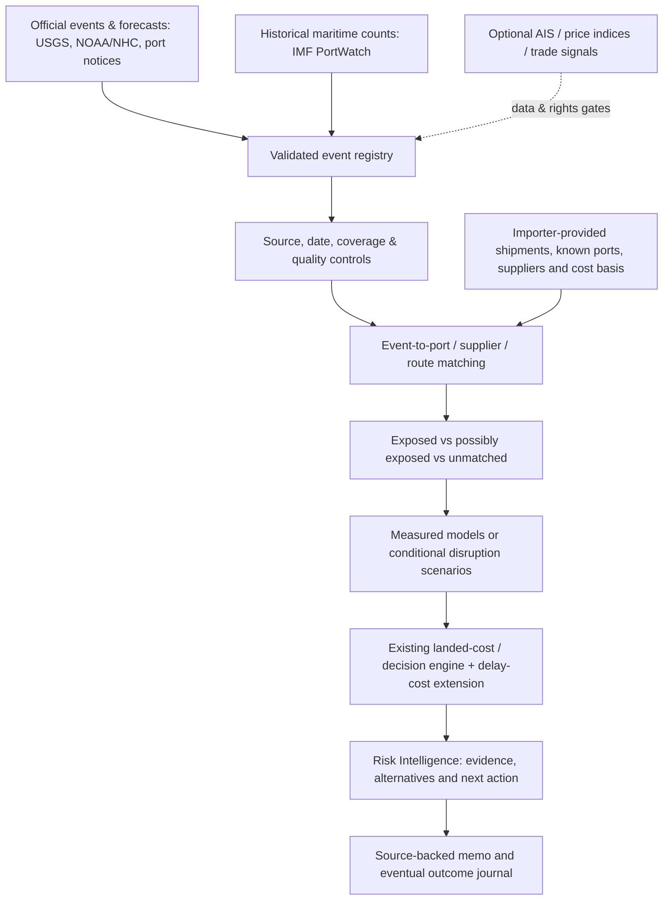

# COST CURRENT — Unified External Intelligence & Predictive Supply-Chain Implementation Plan

**One authoritative Codex handoff** | Version 2.0 — updated after the event-led slice | October 16, 2026  
**Cost Current:** https://github.com/Sambhav255/cost_current  
**Research references:** [WorldMonitor](https://github.com/koala73/worldmonitor) · [God's Eye View](https://github.com/bilawalsidhu/gods-eye-view) · [Awesome Intelligence](https://github.com/ARPSyndicate/awesome-intelligence)  
**Intended reader:** Codex / coding agent implementing this in the _existing_ Cost Current application, with the founder and partner reviewing milestones.

> **USE THIS DOCUMENT ALONE FOR THE WORK DESCRIBED HERE.** It consolidates and supersedes `WORLDMONITOR_SHIPPING_DATA_COST_CURRENT_INTEGRATION.md` and `COST_CURRENT_GODS_EYE_AND_OSINT_INTEGRATION.md`. Neither previous integration document is required, and Codex should **not** reread or independently execute them. This document also contains the product-level context needed to keep the work aligned with Cost Current's predictive-intelligence goal. The current code, live provider rules, and latest verified tests always govern implementation details; do not blindly follow historical plans or outdated handoffs.

> **Mission:** Turn Cost Current from a largely user-assumption-driven shipment calculator into an **event-led, evidence-based supply-chain early-warning and financial decision system**. Add _real observed events and official forward-looking hazards_, explain how they may affect a customer's supply chain, and use the **existing financial engine** for explicitly conditional decisions. Then introduce measurable maritime forecasts once actual historical data and permissions support them. Do not replace working features or imply that observations, rule-based anomaly flags, risk scores, and manual scenarios are calibrated predictions.

---

## 0. CODING AGENT: READ THIS FIRST

**Priority order (follow this sequence; do not implement every item at once):**

1. **P0 — Protect and repair the current shipped event slice.** Inspect local state, fix the failing hosted Prettier gate, verify the latest build and preserve the _already-implemented_ Intelligence → Exposure → Decisions flow. No destructive reset or broad rewrite.
2. **P1 — Add the first genuinely observed official-event vertical slice.** Ingest **USGS observed earthquakes** with clean provenance and reproducible fixture mode, identify potentially exposed _known_ supplier/port locations, open a concise Risk Intelligence event panel and link to a relevant shipment. Connect to **conditional impact analysis** without inventing automatic odds. This is the first _ship-able engineering milestone_.
3. **P2 — Add an official forward-looking weather layer.** Integrate **NOAA/NHC cyclone advisories/forecast track or documented hazard geometry**, with source timestamps and geographic uncertainty, and reuse the same event-to-exposure interaction. Choose the actual authoritative geometry carefully; do not pretend a storm's cone is a port-closure probability.
4. **P3 — Maritime intelligence and historical modeling.** Obtain and validate **one IMF PortWatch** chokepoint time series, build nonprobabilistic anomaly indicators, link a genuinely plausible route, then backtest an objective **future transit-count** target using chronological splits. If data rights/access block production use, do reproducible research/fixture work and report the blocker instead of manufacturing results.
5. **P4 — Expand selectively.** Only if useful and permissioned, add navigational warnings, live AIS aggregates, port activity, weather/wind, fire, policy updates, richer action modeling, and monitored alerts.
6. **P5 — Advanced prediction and commercial maturity.** Calibrated event odds, freight/transit ML, probabilistic decision optimization, live notification infrastructure, customer accounts and economics follow documented data-quality and validation gates.

**Implement P0 → P1 first. Proceed to P2 and P3 only as their acceptance gates pass; stop for founder input only when genuinely necessary (commercial permission, payment, scope ambiguity, or credentials).** P4/P5 are staged backlog, **not permission to build every integration in a single untestable sprint**. Commit and summarize after each milestone. When an essential external permission/data gate cannot be resolved, implement the typed adapter boundary and honest unavailable state, document the blocker, and move to the next independently useful task.

**Do not pause indefinitely at research.** P1 must produce a working visible end-to-end flow and tests. Research must be bounded by the relevant source/API/rights decision. Do not add a visually rich placeholder and call it a finished integration.

### Explicitly protect these current capabilities

- Welcome and workspace overview, existing visual identity, interactive globe and 2D fallback.
- Shipment selection/add/edit, browser persistence, safe reset, CSV template/preview/atomic import, and sample data.
- Cost ledger, duty/freight/other-charge calculations, feasibility rules, timing thresholds, route/supplier comparisons, input validation, and Northstar regression fixture.
- **Forecast** (automatic data only, abstains when unavailable) versus **What if?** (manual probability/scenario assumptions) separation.
- Forecast evidence panel, local freight-observation registry, last-observation baseline, source/rights/quality tracking, and unsupported-event-probability abstention.
- Printable/downloadable decision memos, provenance snapshots, methodology, responsive behavior, keyboard access, and all existing unit/browser tests.

**Remote snapshot verified for this handoff:** `95d6563eb22156dcf4579c43c6a3f78bec314056` on `main` (October 16, 2026). The event-to-decision illustrative intelligence slice **is now implemented**; do not rebuild it as though absent. **Important:** [GitHub Actions run 38866137285](https://github.com/Sambhav255/cost_current/actions/runs/38866137285) failed the Prettier gate on four files, before hosted tests could execute. The prior successful `bc20e9c` run is not a green CI result for `95d6563`. See section 7 for the exact first fix. Local `npm run check` 69 unit tests and 26 browser cases were _reported_ by the implementer but were not independently rerun in this review. Codex must inspect the latest local `git status`, compare to remote, and preserve any newer uncommitted changes.

---

## 1. WHAT WE ARE ACTUALLY BUILDING

### Core product problem

A small or midsize importer cannot easily connect **what might happen globally** with **what is likely to happen to its orders, inventory, landed costs, and cash**. A trade headline, storm forecast, abnormal canal transit count, tariff proposal, or port advisory is not itself a plan. Cost Current should answer:

> **What new risk matters to MY supply chain, why does it matter, how certain is the evidence, what conditional financial outcomes should I prepare for, and which feasible next step can I take?**

The desired experience is **risk-first**. It does not start by forcing every user to create a shipment to see world events, but importer-specific financial answers only become available when the app has relevant customer locations/routes and cost data.

### How it should work — target pipeline



**Important product and modeling distinctions:**

| What is shown                   | Valid statement                                                                                         | Invalid statement                                             |
| ------------------------------- | ------------------------------------------------------------------------------------------------------- | ------------------------------------------------------------- |
| USGS earthquake observation     | “A magnitude X event was reported at this place/time.”                                                  | “This shipment has a Y% chance of delay.”                     |
| NOAA official storm forecast    | “This port/route may lie inside the forecast area.”                                                     | “The NOAA cone says the port will close with Y% probability.” |
| PortWatch change vs past counts | “Observed traffic was X% lower than a qualified reference period.”                                      | “There is an X% chance of a canal shutdown.”                  |
| AIS vessel reports              | “A sampled transponder reported a position/track.”                                                      | “This specific customer container is on that ship.”           |
| Derived rules                   | “Potential exposure due to geographic overlap.”                                                         | “ML has predicted this loss.”                                 |
| Evaluated statistical model     | “Our dated model estimates an outcome distribution for defined horizon/target; here is the test error.” | “The forecast is guaranteed.”                                 |
| Manually entered scenario       | “If disruption causes N days' delay, the modeled cost is $X.”                                           | “The expected loss is $X from automatically estimated odds.”  |
| Market price/index              | “This is a dated market _index_ signal.”                                                                | “This is a USD/FEU customer quote.”                           |

**Differentiation:** WorldMonitor and God's Eye View are primarily about _seeing the world_. Cost Current must be about _customer-specific economic decisions_. A generic world-news feed or a globe packed with ships is **not** the product.

### First customer workflow (test using a fictional, clearly labeled importer)

1. Customer lands on **Risk Intelligence**, sees up to three _relevant_ current/recorded hazards and a dated source-status indicator. The app never equates an empty response to “no risk.”
2. They select a **storm near a known port** or **earthquake near an explicitly entered supplier site**.
3. The event detail explains **what was observed or officially forecast**, source link, event time, available geography, and data freshness.
4. The app shows which saved shipment/location **could** be affected, the **reason** (distance, matched port, or verified lane chokepoint), and the uncertainty/route-mapping confidence.
5. The customer enters a **conditional** disruption assumption (e.g., `4 additional days of delay` + user-supported costs), or reviews an independently calibrated model **if one actually exists**.
6. Cost Current computes the financial effect using transparent inputs and shows feasible next questions/actions, such as checking carrier status, contacting a forwarder, adding safety stock, or comparing an actual alternative quote.
7. A decision memo preserves the exact event data, timestamps, route/exposure basis, user assumptions and calculations. The globe focuses on the event and potentially exposed locations rather than behaving as a generic decoration.

If actual data or customer geographic inputs are absent, show honest states: **“No verified nearby shipment location,” “Route unknown,” “Feed unavailable,” “Impact requires assumptions.”** Never auto-invent coordinates, carrier routes, delay days, vessel assignment, event odds or quotes.

---

## 2. VERIFIED EXISTING TECHNICAL FOUNDATION (NOT A REBUILD)

The reviewed public Cost Current repo is a React + TypeScript/Vite prototype. It has a functioning deterministic financial engine, shipment app, localStorage, CSV import, memo generator, and an isolated freight baseline. Existing files to read _before_ designing abstractions:

- `src/App.tsx` — routing/navigation, shipment state, modes and memos.
- `src/components/Overview.tsx`, `src/components/Intelligence.tsx`, `IntelligencePanel.tsx` — risk-led screens, overview and map layout.
- `src/components/Forecast.tsx` — local freight observation/forecast display.
- `src/components/Analysis.tsx`, `ShipmentForm.tsx`, `Memo.tsx` — conditional analysis, inputs and reports.
- `src/lib/engine.ts`, `types.ts`, `forecast.ts`, `evidence.ts`, `csv.ts`, `storage.ts`, **`riskEvents.ts`, `riskExposure.ts`** — financial, intelligence, type and persistence contracts.
- `docs/FORECASTS.md`, `docs/PROGRESS.md`, `README.md` — baseline behavior and recent handoff, **not** higher-priority feature checklists.
- Existing `*.test.*` and Playwright e2e suites; inspect script names in `package.json`.

**Existing behavior to understand, not alter accidentally:** The fictional Northstar example has $117,000 base landed cost, 40% _manual_ tariff-event probability, 20% _manual_ freight probability, $6,600 hypothetical additional expected cost and $2,500 modeled conditional advantage to ordering early. These are regression fixture results **not automatically estimated event odds**. A prior pre-slice checkpoint passed 60 unit tests and 20 e2e cases; the new event slice reports **69 unit tests and 26 e2e cases locally**, but hosted `95d6563` CI is **red due to formatting**. Codex must independently re-run tests against its current tree. Some older documentation refers to now-completed UI changes; treat the code as the source of truth.

**Critical architecture rule:** `src/lib/forecast.ts` currently expects an `USD_cents_per_FEU` input for its narrow freight baseline. **Do not feed PortWatch vessel counts, shipping index numbers, NOAA wind speed or other measurements into it.** Use new source-specific normalized measurement types and separate predictive targets. Only an appropriate actual comparable `USD/FEU` dataset belongs in the freight price target.

**Application boundary:** The current prototype is primarily browser-local. It may not have secure production server endpoints. Add a small, deployable same-origin endpoint, serverless function or build-time ingest as dictated by the actual repository; **do not migrate to Next.js, introduce Kubernetes, or deploy a complicated backend for one feed.** Keep customer data local unless the founder explicitly authorizes moving it to a secure backend. Secrets must never be embedded in browser bundles.

---

## 3. CONSOLIDATED RESEARCH: WHAT THE EXTERNAL PROJECTS REALLY PROVIDE

The code/source assessment was based on these public snapshots, not a live validation of provider licenses, API health or data quality:

| Reference                                                                    | Reviewed tree ID                           | What to use it for                                                                                                            | What not to assume                                                                                                     |
| ---------------------------------------------------------------------------- | ------------------------------------------ | ----------------------------------------------------------------------------------------------------------------------------- | ---------------------------------------------------------------------------------------------------------------------- |
| [WorldMonitor](https://github.com/koala73/worldmonitor)                      | `a4af9d393ed3a0bd90a487f959731762ec62908a` | PortWatch ingestion architecture, chokepoints, freight index taxonomy, routing/exposure, cache/data freshness, alert patterns | A free shipping price feed; calibrated closure odds; free commercial API rights; permission to reuse its AGPL app code |
| [God's Eye View](https://github.com/bilawalsidhu/gods-eye-view)              | `e2274bbf0ceaeb2e14f8a59d63e77000553c6816` | MIT-source patterns for bounded AIS backend, watchdog, USGS/NHC/NASA source clients, event/geospatial interactions            | Its live transponder data are comprehensive; all bundled datasets/tiles/models are MIT; it predicts customer delay     |
| [Awesome Intelligence](https://github.com/ARPSyndicate/awesome-intelligence) | `9a8002e2939ed5957a6c8299e9af5159d342244b` | CC0 source discovery directory (~513 records)                                                                                 | That it runs an ingestion API, validates commercial rights, or that archived links remain usable                       |

### 3.1 WorldMonitor — the maritime and routing reference

Its implemented architecture combines:

- **AISStream** authenticated near-real-time AIS observations into long-lived relay, geographic density/disruption computations, cached snapshots and map layers. See [AIS relay](https://github.com/koala73/worldmonitor/blob/main/scripts/ais-relay.cjs), [maritime snapshot RPC](https://github.com/koala73/worldmonitor/blob/main/server/worldmonitor/maritime/v1/get-vessel-snapshot.ts), and [AIS watchdog](https://github.com/koala73/worldmonitor/blob/main/shared/ais-watchdog.js).
- **IMF PortWatch** daily/historical counts via ArcGIS, with dedicated [chokepoint](https://github.com/koala73/worldmonitor/blob/main/scripts/seed-portwatch.mjs) and [port activity](https://github.com/koala73/worldmonitor/blob/main/scripts/seed-portwatch-port-activity.mjs) jobs.
- **Freight indices** from FRED, Shanghai Shipping Exchange and Baltic-related publications; source code is [seed-supply-chain-trade.mjs](https://github.com/koala73/worldmonitor/blob/main/scripts/seed-supply-chain-trade.mjs).
- Chokepoint statuses, reviewed/curated geography, bypass corridors and country-pair exposure: [chokepoint registry](https://github.com/koala73/worldmonitor/blob/main/src/config/chokepoint-registry.ts), [route explorer](https://github.com/koala73/worldmonitor/blob/main/server/worldmonitor/supply-chain/v1/get-route-explorer-lane.ts), [bypass options](https://github.com/koala73/worldmonitor/blob/main/server/worldmonitor/supply-chain/v1/get-bypass-options.ts).
- A [Pro-gated Shipping v2 API](https://github.com/koala73/worldmonitor/blob/main/docs/api-shipping-v2.mdx) returning route exposures/score/bypass and shipping disruption webhooks. These are **WorldMonitor service outputs**, not independently owned Cost Current data.

**What matters in the code:** WorldMonitor's chokepoint disruption score combines **assigned geopolitical threat levels, navigational warnings and AIS severity**. It is a _heuristic severity index_, **not** a learned probability. Route geography and bypass timing/cost ranges frequently depend on curated static tables and generalized country/port clusters; these are not confirmed carrier paths or contract prices. A missing data feed must **not** become a healthy score of zero, a problem some fallback designs can accidentally introduce.

### 3.2 The three non-interchangeable kinds of “shipping data”

| Data class                | Real observed measure                                                                 | Possible Cost Current use                                             | Strict limit                                                                                 |
| ------------------------- | ------------------------------------------------------------------------------------- | --------------------------------------------------------------------- | -------------------------------------------------------------------------------------------- |
| AIS messages              | Vessel-reported position, time, type, speed/heading, possibly name/destination        | Geographically bounded traffic context; eventual anomaly features     | Not a verified specific customer container, not complete global coverage, not freight quotes |
| IMF PortWatch             | Aggregated daily ship/transit/port counts, cargo classes, sometimes estimated volumes | Historical anomaly statistics and future _transit-count_ forecasting  | Not truly live vessel positions or a forwarder's price                                       |
| Economic/shipping indices | Indexed economic or freight movements                                                 | Macro controls and separate index forecast targets where rights allow | Not inherently USD/FEU, not customer contract pricing                                        |

**FRED series located in WorldMonitor:** `PCU483111483111` (Deep Sea Freight Producer Price Index) and `TSIFRGHT` (Freight Transportation Services Index). These are monthly **indices**. The Shanghai Shipping Exchange publishes SCFI/CCFI (index family). Baltic Dry family is primarily bulk-market pricing. None of these should be silently converted into a comparable customer container **USD per forty-foot equivalent unit (FEU)** series. A customer-supplied, permissioned sequence of truly comparable quotes is a more appropriate rate forecast target.

### 3.3 PortWatch technical starting point

WorldMonitor identifies this queryable ArcGIS layer:

`https://services9.arcgis.com/weJ1QsnbMYJlCHdG/arcgis/rest/services/Daily_Chokepoints_Data/FeatureServer/0/query`

Related services in WorldMonitor's source include `Daily_Ports_Data/FeatureServer/0/query` and `PortWatch_ports_database`. **Codex must inspect the official layer metadata and field definitions at implementation time, and derive robust parsing from what the service actually returns**; do not hard-code a mistaken field/type merely because another project used it. Respect pagination, page caps, retries, provider rate limits, missing dates, report revisions, units, and partial coverage. Store retrieval and observation dates separately. This URL demonstrates public accessibility, **not** a grant for commercial scraping, training or redistribution.

Candidate first metric: **daily container-vessel transit count** at one carefully chosen chokepoint, where the published measure actually supports that label. If insufficient coverage, fall back to a more reliably labeled total-vessel transit measure. Show the unit prominently. The initial maritime indicator is a deviation from history, not a learned event-closure probability.

### 3.4 God's Eye View — event and interaction reference

Actual source files:

- [USGS earthquake source](https://github.com/bilawalsidhu/gods-eye-view/blob/main/src/layers/earthquakes/source.js): requests and validates an official GeoJSON feed.
- [NOAA cyclone source](https://github.com/bilawalsidhu/gods-eye-view/blob/main/src/layers/cyclones/source.js): validates advisory times and forecast track/cone geometry.
- [NASA FIRMS fire source](https://github.com/bilawalsidhu/gods-eye-view/blob/main/src/layers/firms/source.js): near-real-time fire observations via an authorized data source/key.
- [AIS server](https://github.com/bilawalsidhu/gods-eye-view/blob/main/server/providers/vessels/ais-live.js), [AIS store](https://github.com/bilawalsidhu/gods-eye-view/blob/main/server/providers/vessels/ais-store.js), [WebSocket transport](https://github.com/bilawalsidhu/gods-eye-view/blob/main/src/data/aisStreamAdapter.js), [maritime query tools](https://github.com/bilawalsidhu/gods-eye-view/blob/main/src/tools/queries/maritime.js).
- [Provider/license inventory](https://github.com/bilawalsidhu/gods-eye-view/blob/main/DATA_SOURCES.md).

**Reusable interaction ideas:** one-click map focus and evidence panel, minimal default layers, timeline/recorded replay, status/age indicators, deep link to _nonsensitive_ event/map context, and bounded regional vessel/traffic overlays. **Do not** copy the espionage-themed visuals, voice cockpit controls, public CCTV, arbitrary satellite animations, or huge global ship icons into an importer workflow.

GEV's AIS adapter uses a **server-side** authenticated WebSocket rather than exposing the key/client stream in the browser, with bounded snapshots, deduplication, freshness limits, auth/rate-limit/transport error classification and backoff. Live vessel tracking is P4, **not required to complete P1–P3**.

### 3.5 Awesome Intelligence — leads, not integrations

Its archived [`intel.json`](https://github.com/ARPSyndicate/awesome-intelligence/blob/main/intel.json) includes **MarineTraffic**, **VesselFinder**, **My Ship Tracking**, **NAVTEX archive**, **NASA FIRMS**, **ReliefWeb**, **ACLED**, **OpenSanctions**, **SIPRI**, **Crisis Group**, **AviationStack**, weather map services, and satellite suppliers. These are **individual vendor websites** with different data models, terms, and reliability. Having a public URL, free human-facing map, or a link in a CC0 directory **does not** grant an API, scraping privilege, commercial republishing rights or ML-training rights.

**Consolidated shortlist:** Official NOAA, USGS, IMF PortWatch, and narrowly scoped official maritime notices first. NASA FIRMS next if factory wildfire impact is a target workflow. ReliefWeb for corroborating reports/news events when allowed. ACLED/OpenSanctions only after paid/proper commercial licensing if justified. Consider MarineTraffic/VesselFinder **commercial data purchase** only if real shipment/carrier tracking becomes a customer requirement. **Do not scrape their websites.**

---

## 4. SOURCE PRIORITY, AUTHORIZATION AND ECONOMIC VALUE

**Rights categories:** `approved_prototype`, `research_only`, `commercial_approved`, `pending_review`, `restricted`, `unavailable`. Distinguish rights to **fetch**, **cache**, **display**, **redistribute**, **train**, **retain history**, and **ship commercially**. One green boolean is not enough.

| Source                                     | Core variable/use                                        | Access / likely costs                                                                  | Permission status to establish                                                             | Priority                    |
| ------------------------------------------ | -------------------------------------------------------- | -------------------------------------------------------------------------------------- | ------------------------------------------------------------------------------------------ | --------------------------- |
| **USGS earthquake GeoJSON**                | Observed quake point, magnitude, UTC event/update times  | Public official feed; straightforward HTTP, subject to fair use and operational limits | Check USGS attribution/disclaimer and service rules; normalize exactly                     | **P1**                      |
| **NOAA/NHC official storm advisory/track** | Official forward-looking weather hazard                  | Public official data; no upfront per-call feed assumed                                 | Verify advisory format, coverage, forecast geometry, attribution                           | **P2**                      |
| **IMF PortWatch**                          | Historical port and chokepoint ship/volume activity      | Public ArcGIS/PortWatch data; ingestion effort & throttling                            | **Commercial display, storage, derived alerts, training/redistribution remain unverified** | **P3**                      |
| **Official navigational/port warnings**    | Observed route safety or operating advisories            | Source-specific; official providers often publish freely                               | Verify publication/coverage/retention                                                      | P4 candidate                |
| **FRED index series**                      | Slow-moving freight/macro _index_ controls               | FRED API key; no container quote                                                       | Series-level third-party restrictions, API terms, attribution                              | P4 candidate                |
| **Shanghai Shipping Exchange SCFI/CCFI**   | Container index context                                  | Public-looking endpoint                                                                | **Commercial reuse restricted absent written authorization**; do not ingest for production | **Blocked pending license** |
| **Baltic/HandyBulk publication**           | Bulk freight index context                               | Published site content                                                                 | Copyright/licensing and mismatch with container target                                     | Defer                       |
| **AISStream**                              | Vessel observations and traffic context                  | Registration/key; WebSocket infra                                                      | Beta/free appearance ≠ explicit commercial/derived-data rights; confirm in writing         | Optional P4                 |
| **NASA FIRMS**                             | Thermal anomalies/fire points                            | API/MAP_KEY; rate limits                                                               | Provider terms; event is a detection, not facility damage                                  | Optional P4                 |
| **ReliefWeb**                              | Disaster/humanitarian source corroboration               | Public catalog/API; potential request limits                                           | Content-specific rights, attribution & linkback; avoid fulltext republication              | Optional P4                 |
| **ACLED**                                  | Structured conflict occurrences                          | Licensing may apply                                                                    | **Commercial use and training require explicit permission**                                | Hold                        |
| **OpenSanctions**                          | Counterparty/sanctions intelligence                      | Paid commercial terms depending use                                                    | Do not bundle its noncommercial datasets in paid SaaS                                      | Hold                        |
| **WorldMonitor hosted API**                | Composite chokepoints, route intelligence, alert webhook | Service plans published; not automatically free                                        | Pro/API plan, customer redistribution and upstream conditions                              | Optional paid supplier      |
| **GEV/WorldMonitor code**                  | Implementation patterns                                  | GEV MIT / WorldMonitor AGPL                                                            | Code licenses do **not** cover their providers' datasets/assets                            | Reference only for now      |

**WorldMonitor published plan context at review** (subject to change): public dashboard $0; Pro $39.99/month personal; Pro Business $49.99/month named commercial analysis but not customer-facing redistribution; API Starter $99.99/month internal use; API Business $299.99/month with limited R1–R3 customer-facing redistribution, still subject to restrictions. See [their published pricing](https://github.com/koala73/worldmonitor/blob/main/public/pricing.md) and [EULA](https://www.worldmonitor.app/docs/eula). **Do not automatically subscribe, pay, embed private keys or call premium routes without founder approval.** WorldMonitor's [Shipping v2 API](https://github.com/koala73/worldmonitor/blob/main/docs/api-shipping-v2.mdx) is explicitly Pro-gated and requires a server-side key.

**Code licensing:** WorldMonitor platform is **AGPL-3.0-only**; a proprietary combined deployment may trigger source-availability obligations, and a separate commercial license may be necessary. Its thin SDKs/CLI may be MIT but using them never overrides hosted API rights. God's Eye View **application code is MIT** with notice preservation; its third-party **datasets, satellite tiles, 3D models, imagery and certain noncommercial assets are excluded**. In particular, avoid its noncommercial TeleGeography submarine-cable bundle and noncommercial Bhote Koshi imagery. Awesome Intelligence directory is **CC0**, but CC0 does not attach to its linked services. Original implementation with documented attribution is the default.

**Source due diligence deliverable:** create/update a small registry in Cost Current (e.g. `docs/DATA_SOURCE_REGISTER.md` plus typed metadata), with URLs, observed measures, units, API version/schema, terms link, access mode, geography, cadence, latest actual coverage, attribution text, cache/redistribution/training rights status, owner/review date and failure behavior. These registry entries are factual reports, not optimistic guesses.

---

## 5. TARGET UX: SIMPLE, EVENT-FIRST AND FINANCIALLY RELEVANT

**Do not add seven new main navigation tabs.** Reuse the recently simplified shell and make one **Risk Intelligence** landing area. Keep Overview/shipments, Analysis, Import, Decision Memo and Methods reachable; combine or rename existing nav labels only after inspecting the latest local design and testing the flow.

**Recommended main screen hierarchy:**

1. **Header:** “What could disrupt your supply chain?” with an unobtrusive as-of timestamp, provider state, and two filters: `Relevant to me / All observed` and `Observed / Official forecast / Scenario`.
2. **Top 1–3 event rows:** headline, event class, geography, when, source and a **relevance label**, e.g. “Possible match: supplier in review radius” (not “high risk” without evidence). If there are no relevant events, an honest “No qualifying matches in currently available sources” message with feed coverage.
3. **Selected event detail:** “What happened or may happen,” primary source link, evidence and date, why the user's port/supplier/route might be exposed, what we **don't** know, and one prominent “Review impact” action.
4. **Geographic panel:** Existing globe/2D fallback. Focus on selected event, verified/supplied customer locations, and only supported route corridors. Keep irrelevant layers off by default. Show a **legend distinguishing official hazard geometry, known customer points, and illustrative/estimated route lines**.
5. **Financial panel:** Reuse current cost view, optionally adding a **conditional delay-cost** calculation. Prominently state the assumed delay/shock and whether any objective event probability exists.
6. **Progressive disclosure:** detailed series plots, old scenarios, data diagnostics, proof/source URLs, quote scope, original calculation ledger, model evaluation and raw evidence remain accessible but aren't equal visual priorities.

**Onboarding:** Without customer ports/sites/shipments, let visitors explore external intelligence and explicit fictional demo examples, but explain that shipment-specific exposure needs a known asset. Permit input of a port/supplier **coordinate or selected vetted port**, never silently geocode a vague company name into a certified facility location.

**Status design:** `Observed`, `Official forecast`, `Research estimate`, `Model forecast (evaluated)`, `Illustrative fixture`, `User what-if`, `No coverage`, `Stale`. These should be textually clear and not rely on colors alone. The timestamp must correspond to the **publisher's** known time, not merely the browser retrieval time.

**No operationally misleading “Live” badges:** if data are fetched hourly, if a fixture is being replayed, or if the provider is stale, say so.

---

## 6. IMPLEMENTATION BLUEPRINT — DOMAIN AND DATA CONTRACTS

Implement a minimal typed core; adapt naming to project conventions instead of imposing these literal filenames/types blindly. Avoid coupling provider adapters to components or `engine.ts` directly.

```ts
// Illustrative shape; refine into strict runtime-validated types.
type SourceMode =
  'observed' | 'official_forecast' | 'evaluated_model' | 'user_scenario' | 'fixture';
type FeedStatus = 'fresh' | 'stale' | 'unavailable' | 'invalid' | 'permission_required';
type ExposureBasis =
  | 'verified_port_match'
  | 'user_supplied_site_proximity'
  | 'documented_route_intersection'
  | 'schematic_route_possibility';

type IntelligenceSource = {
  id: string;
  provider: string;
  authoritativeUrl: string;
  termsUrl?: string;
  attribution: string;
  fetchRights: 'approved' | 'pending' | 'blocked';
  displayRights: 'approved' | 'pending' | 'blocked';
  commercialRights: 'approved' | 'pending' | 'blocked';
  trainingRights: 'approved' | 'pending' | 'blocked';
  retentionPolicy?: string;
};

type IntelligenceEvent = {
  id: string; // stable provider-derived ID, not random per refresh
  sourceId: string;
  type: 'earthquake' | 'cyclone' | 'maritime_anomaly' | 'fire' | 'port_notice' | 'trade_policy';
  sourceMode: SourceMode;
  title: string;
  geometry: GeoJSON.Geometry | null; // point, official line, or polygon; keep authoritative meaning
  eventTime?: string; // actual occurrence, if observed
  publishedAt?: string; // issuer event/update time
  issuedAt?: string; // forecast issuance, if applicable
  validFrom?: string;
  validUntil?: string;
  observedAt?: string;
  retrievedAt: string; // system retrieval, never substituted for an observation date
  sourceUrl: string;
  sourceRecordId: string;
  feedStatus: FeedStatus;
  metric?: { value: number; unit: string; definition: string };
  notes?: string;
};

type ExposureMatch = {
  eventId: string;
  shipmentId: string;
  assetType: 'port' | 'supplier_site' | 'route_segment';
  assetId: string;
  basis: ExposureBasis;
  matchReason: string;
  distanceKm?: number;
  geographySource: 'customer' | 'reviewed_port' | 'schematic';
  matchState: 'possible' | 'confirmed_by_source' | 'unmatched' | 'unknown';
  operationsVerified: boolean;
};

type ConditionalImpact = {
  eventId: string;
  shipmentId: string;
  probability: null | number; // null unless a defensible calibrated model exists
  assumedDelayDays?: number; // user's scenario, not generated from a mere overlap
  delayCostUsd?: number;
  expeditingUsd?: number;
  stockoutUsd?: number;
  impactUsd?: number;
  evidenceIds: string[];
  mode: 'user_scenario' | 'evaluated_model';
};
```

### Boundaries and failure design

- **Provider adapter:** fetch, validate (using a runtime schema), normalize, return typed event/observation objects with source IDs and timestamps. No UI HTML parsing; don't copy site dashboards. Support bounded request sizes, pagination where needed, deadlines, response limits, careful retry/backoff and graceful unavailable/stale states.
- **Event registry:** stable source+event IDs, upsert/dedup, preserve latest publication and revisions, report unresolved/missing geometry and stale data; keep observed and forecast events logically distinct.
- **Geospatial match:** use vetted coordinates, a documented distance threshold or geometry intersection in an appropriate geospatial method/projection; address ±180° wrap and polygon holes; don't assume all schematic route lines mean actual passage. For NOAA track, compare a **reviewed polygon/official hazard area** only if the chosen source provides one; a mere centerline proximity is a different weaker match.
- **Forecast service:** separate from event collection; model predictions must have target definition, unit, horizon, `issuedAt`, `trainingCutoff`, `modelVersion`, input source IDs, interval/uncertainty and **actual out-of-sample metrics**. If insufficient, `prediction: null` with reason.
- **Cost integration:** never map a hurricane directly to a tariff increase. A new **delay/handling cost scenario** should use shipment-specific inventory, margin, expediting and warehouse inputs if present; otherwise stop and ask for assumptions. Keep existing tariff/freight What-if untouched and tested.
- **Data provenance:** preserve a minimal decision snapshot with exact received/source timestamps, event version and assumption mode. Never mix fixture-generated information into a live provider cache.
- **Security:** if running a server, keep API keys server side; constrain upstream hosts and HTTP methods, block arbitrary user-supplied URLs/SSRF, validate bounds and sizes, rate limit any expensive endpoint, and never include customer cost or site data in publicly shareable event URLs.
- **Offline/demo:** checked-in lightweight recordings of legitimate historical source responses can be used where rights allow and are explicitly marked `recorded fixture`; synthetic values must say `fictional`. Handle endpoint outage without substituting fictional data into live mode.

**Suggested organization (adapt to repository conventions):**

```text
src/lib/intelligence/          # source/event/exposure types, validation, geo matching
src/lib/intelligence/providers # source adapters or browser-safe clients to own backend
src/lib/intelligence/impact    # optional conditional delay-cost math and source snapshots
src/components/RiskIntelligence.tsx
src/components/RiskEventDetail.tsx
src/components/RiskLayerLegend.tsx
server/ or api/               # only if needed for provider keys/CORS/normalization
fixtures/intelligence/       # source recordings + separate synthetic examples
...tests...                   # parser, geo, source rights, scenarios, e2e
```

This is a **conceptual dependency map**, not instructions to create empty scaffolding everywhere. Prefer a few cohesive, testable modules over an elaborate unused package architecture.

---

## 7. REVIEW OF THE LATEST PUSHED COST CURRENT SLICE AND SCREENSHOTS

### 7.1 Latest verified development status

| Item                                                          | Present in pushed `95d6563` | Consequence for this plan                                                               |
| ------------------------------------------------------------- | --------------------------- | --------------------------------------------------------------------------------------- |
| Welcome → Intelligence → shipment exposure → What if?         | Yes, code and tests         | **Retain and extend**; do not build a parallel Intelligence page                        |
| `src/lib/riskEvents.ts` illustrative events/signals           | Yes                         | Evolve registry into sourced observations with stable IDs; keep demo namespace separate |
| `src/lib/riskExposure.ts` matching and conditional dollars    | Yes                         | Tighten applicability and unknown states; add site/port/time evidence                   |
| China tariff demo + Red Sea/Suez demo                         | Yes                         | Preserve as visible fictional examples; add separate observed feed mode                 |
| `src/components/Intelligence.tsx` and `IntelligencePanel.tsx` | Yes                         | Extend with filters, source/status, clearer hierarchy; don't rebuild shell              |
| 2D event watch markers                                        | Yes                         | Do not label as polygon/hazard extent; 3D parity optional engineering polish            |
| User-adjustable tariff/freight scenario calculator            | Yes                         | Keep What if? separate from official data                                               |
| Last-observation freight baseline                             | Yes                         | Preserve `USD_cents_per_FEU` contract; never fill it with traffic counts                |
| Automatically calibrated event probability                    | **No**                      | Display `Unavailable`, never invent probability                                         |
| Official observed hazard data ingestion                       | **No**                      | **New first P1 target**                                                                 |
| Rights-reviewed PortWatch time series/model                   | **No**                      | P3 after P1/P2                                                                          |
| CI for latest commit                                          | **Failed** on formatting    | **First blocking engineering fix**                                                      |

**Exact CI incident:** latest pushed run `38866137285`, commit `95d6563`, failed `npm run check` → `prettier --check .` on:

- `docs/PREDICTIVE_INTELLIGENCE_PLAN.md`
- `docs/PROGRESS_ARCHIVE.md`
- `docs/PROGRESS.md`
- `scripts/capture-screenshots.mjs`

Fix with the pinned project's Prettier tooling (`npx prettier --write` **only those files**, after reviewing whether there are newer local edits), then `npm run check` and `npm run test:e2e`; commit and push a targeted formatting fix. **Do not suppress formatting globally or declare CI green until the _new_ GitHub Actions run completes successfully.** A successful previous commit's CI run does not certify this commit.

### 7.2 Important logic corrections discovered in the actual code

1. **Unknown corridor is not automatically “not applicable.”** In `riskExposure.ts`, `!route?.viaCorridor` returns `not_applicable`. For an unknown/imported route this overstates confidence. Introduce an explicit `routeEvidence`/itinerary review state. Preserve the existing Northstar/Suez negative test **only where the reviewed sample route is explicitly established not to traverse Suez**. For routes with no evidence, use `unknown` or `possible — needs route confirmation`, not a negative assertion. Do not infer Suez merely because Shanghai → Rotterdam sounds likely, nor infer avoidance solely from missing metadata. Preserve `nordic-home` reviewed-demo match and revise tests to make the confidence distinction testable.
2. **Holding days ≠ predicted delay days.** `conditionalImpact()` for `chokepoint` currently returns `estimatedDelayDays: shipment.holdingDays || null`. `holdingDays` is the inventory/carrying-cost parameter in existing cost logic. **Remove this accidental meaning shift.** Add a distinct nullable scenario `assumedDisruptionDelayDays` (and optional sourced transit delay forecast only when evaluated), with clear data migration; until available return `null` delay. Do not silently overwrite holding days.
3. **Tariff scope is too loose for non-demo use.** The product check accepts words such as `home` or the sample ID `northstar`. That is appropriate only for the fictional demo. For real policies use exact official event/HTS/origin/effective-date applicability or `unknown` pending human/broker review. Never equate a word match with legal duty applicability.
4. **The current 40% demo tariff odds are not sourced.** They come from `DEMO_PROBABILITY_SIGNALS`, intentionally marked `user_assumption`. Do not promote these into the observed feed, nor include the same event twice as independent evidence. Event-to-What-if transfer must visibly use manually confirmed shocks, not automatically produce new probabilities.
5. **Map route choice is not event-specific.** `Intelligence.tsx` chooses its focus route by `nordic-home` / `northstar` presence, not by the selected event's best-supported exposed shipment. Replace with an event-relevant, validated focus rule; if nothing matches, center on the event location. Do not auto-label a ship route path as a real GPS or scheduled itinerary.
6. **Dots are not a hazard polygon.** `MapFallback.tsx` renders event `points` as circles and labels. Describe them as _watch locations/illustrative corridor markers_ rather than official coverage or closure boundaries. Official USGS point and NHC track/cone geometry require separate representations and legends.
7. **Portfolio 'expected extra cost' remains assumption-based.** `Overview.tsx` correctly adds a qualification, but keep it visible next to the monetary number, including in exports. Do not merge it with event-level `conditionalExtraCost` or sum events across shipments without deduplication and temporal overlap handling.
8. **Decision context freshness.** On event → Decisions navigation, preserve a specific immutable event ID/version and clarify where What-if values originated. A user viewing another shipment or changing event should not keep an outdated event banner or accidentally apply a prior scenario to a new route.

These fixes are **targeted and test-driven**. They do not authorize changing the validated canonical Northstar arithmetic or disabling old features.

### 7.3 Product / UI judgment from the new event-led screenshots and code

The interface has moved in the right direction: the front door now emphasizes possible disruptions and presents a route toward customer financial exposure. But it still behaves more like a **two-event demonstration**, not a monitoring system: only scripted event cards, a dense explanatory detail section, and a map that is largely schematic. The visible `Not available` probability state is a _correct honesty feature_, not a UI bug to fill with fake numbers.

**Improved hierarchy without another wholesale redesign:**

- In Intelligence, show a clean `Relevant to my supply chain` feed with readable event cards. Put `Observed / Official forecast / Illustrative` and the exact provider/date next to each card; separate demo data from real feed state in a filter or dedicated sample selector.
- A selected event should answer in order: **What happened or might happen? → Which of my known assets are near it? → What is actually known about impact? → What can I decide or verify?** Keep raw thresholds, scoring, source diagnostics in a collapsible evidence area.
- Avoid a large page of equal-weight descriptions. Use one main narrative and a concise `Affected shipments` table. Sort _confirmed evidence_ ahead of possible/unknown, not by invented severity points.
- Globe/2D should focus and highlight the actual selected event, source geometry and user-provided assets; do not dominate the page with all demo route lines. Map is an explanation of exposure, not the forecasting algorithm.
- For a live earthquake, show magnitude, official origin/update time, distance to a **verified site/port coordinate**, and uncertainty; **do not** show a dollar impact until a customer supplies an operational shock assumption or we have a validated effect model.
- For official cyclone forecasts, distinguish future forecast from observed storm center and describe spatial uncertainty; never convert official storm cone geometry into carrier closure probabilities.
- On `Explore options`, take the user to the existing decision engine with a **clearly labeled conditional scenario** (e.g. “Assume port disruption causes 3–7 additional days — user-entered”). Preserve history/memo/evidence context, if offered.
- Keep Import, My Exposure, Forecast vs What if?, ledger and Methods easily reachable; do not add 8 more navigation tabs or replicate a Bloomberg-style feed.

**UX acceptance test:** a new user can (a) find a verified, date-stamped event, (b) understand one _possible_ link to a site/port, (c) see what is _not_ known, (d) enter a plausible assumption, (e) inspect dollars and two response choices in **three transitions or fewer**, without encountering an invented probability.

---

## 8. STAGED ENGINEERING EXECUTION — DO IN ORDER

### P0 — Stabilize pushed `95d6563` and protect user data

**Goal:** latest work green and recoverable, no changes to business logic except separately tested defects.

1. `git status --short --branch; git log -5 --oneline; git remote -v`; inspect upstream HEAD and active worktrees. If uncommitted edits exist, **preserve** them; do not auto-reset, stash-and-forget, or overwrite concurrent agents' files.
2. Run format check and targeted formatting fix described in 7.1. Run `npm run check` and `npm run test:e2e`; inspect scripts if the environment needs browser setup. If Playwright cannot run here, state the specific blocker; do not claim green.
3. Run tests covering Northstar arithmetic, What if? and Forecast separation, CSV atomicity, evidence/memo snapshots, desktop/mobile navigation, demo China and Suez matches. Capture results and limitations.
4. Save a checkpoint in Git after verifying changes. Push only with normal user permission/workflow; watch hosted Actions until the latest commit is green. Do not import new packages or paid credentials yet.
5. Update `docs/PROGRESS.md` with fresh CI status; keep archival handoff in `docs/PROGRESS_ARCHIVE.md`. Update product plan pointer to **this document** as integration execution source of truth, while retaining `docs/PREDICTIVE_INTELLIGENCE_PLAN.md` as the **product-direction** plan.

**Gate P0:** latest committed code compiles; all prior tests pass; latest hosted quality workflow is green or there is an explicit external CI blocker; no local changes lost.

### P0.5 — Correct semantic gaps before external data flows

**Goal:** avoid turning demo shortcuts into erroneous real-world recommendations.

- Split `demo_*` event registry from `official_observations` and `official_forecasts` with distinct UI labels/data pathways. New source events must have externally stable IDs and never be labeled `reviewed demo match`.
- Implement origin/destination port/site identity and geospatial **evidence** fields as an additive structure. Never infer a precise supplier point from company name alone.
- Separate `assumedDisruptionDelayDays` from inventory `holdingDays`. Use explicit null when unknown, preserve old stored objects and avoid unrequested default delay assumptions.
- Represent corridor matching as `known_traverses`, `known_avoids`, `unknown`; derive `reviewed`, `not_applicable`, `unknown` accordingly, with sample known-avoids test. Keep source and effective-date scope for policy outcomes.
- Make event-to-decision context immutable and visibly labeled; preserve memo/CSV/evidence regressions.
- Add small, deterministic unit tests for each state before touching any new source.

**Gate P0.5:** live events can be stored with `unknown` probabilities and matching states without borrowing any fictional demo data, and legacy shipment storage still loads.

### P1 — USGS official earthquake observation → possibly exposed customer asset → What if?

**Why first:** public primary source, readily parsed point data, testable in offline fixtures, and a meaningful pattern for any future event. **USGS does not publish shipment delay or cost probabilities.**

**Source:** official [USGS real-time GeoJSON feeds](https://earthquake.usgs.gov/earthquakes/feed/v1.0/geojson.php), e.g. `https://earthquake.usgs.gov/earthquakes/feed/v1.0/summary/all_day.geojson`. Follow provider update/disclaimer, stable event `id`, event origin `time`, modification `updated`, latitude/longitude, depth and magnitude. A feed snapshot is not a complete historical record.

**Tasks:**

1. Confirm source terms/freshness/attribution for prototype display. Record in `docs/DATA_SOURCE_REGISTER.md` **before** production calling. Implement same-origin fetch if browser CORS or quotas require it; a simple serverless backend is fine. Do not add insecure arbitrary URLs.
2. Create a typed `USGS` adapter with response size limit, 10s timeout, proper HTTP status, runtime validation, bounded row count, stable event IDs (e.g. `usgs:<id>`), timestamp conversion, magnitude, point coordinates, and direct authoritative event URL. Preserve observation/update/retrieval times separately. Deduplicate by provider ID and distinguish revised observations.
3. Expose an event feed service with `fresh`, `stale`, `unavailable`, `permission_required`, `invalid` states, and independently selectable `illustrative_demo` mode. **If current USGS feed has zero nearby earthquakes, show a truthful empty state.** For testing use deterministic recorded/synthetic fixtures labeled appropriately; do not substitute fixtures invisibly when network fails.
4. Add a **user-confirmed port** or **supplier-site** coordinate workflow. Existing demo may use a clearly identified fictional test port and a synthetic quake fixture near its location, but never claim an actual quake hit a live customer. Use simple great-circle/haversine distance for point-to-site screening, with a configurable screening radius. Distance indicates _potential relevance_, not physical damage/closure.
5. On the Intelligence page, user chooses an official quake; show magnitude and age; event geo focus; matched sites/ports with distance, match type, and `Possible — requires operational confirmation` (or no match). If port not defined, require site/port identity rather than infer from country alone.
6. Connect `Review impact` to existing What if? or a small conditional delay-impact subpanel: explicitly request user-estimated days of delay, handling fees, inventory holding/stockout/expedite assumptions. Do not invent causality, carrier behavior, odds, or “estimated loss” without user input.
7. Write tests: normal feed, empty feed, corrupt payload, duplicate/revised ID, missing coordinates, future timestamp, stale response, HTTP 429/503, distance boundary, unmatched port, unknown route, scenario origin/evidence separation, mobile clickthrough.

**Minimum demo fixture:** a `fictional_usgs_like` quake event near a **fictional known port asset**. It must never masquerade as the actual USGS feed. Production mode always displays actual returned USGS event records or honest unavailability.

**P1 acceptance:** one real provider URL can be fetched read-only, authoritative dated events display with source links, event→site→scenario flow works, and manual cost outputs remain conditional. The _current_ realtime feed might have no relevant events; that is acceptable.

### P2 — NOAA/NHC forecast weather intelligence → possible port/route exposure

**Source:** NOAA/National Hurricane Center and Central Pacific Hurricane Center official alerts. Start with US coast-relevant Atlantic/Eastern/Central Pacific products; this is **not global typhoon coverage**. Do not use an unaffiliated weather widget as a primary source.

**Tasks:**

1. Inspect official machine-readable advisory/track/cone products, issuance time, advisory ID, valid time, forecast time steps, ocean basin and geography. Confirm rights, display disclaimers, supported coordinate standards and update cadence. If machine geometry isn't reliable, implement a bounded source-status adapter and honest unavailable/limited display first.
2. Normalized event and forecast-geometry types must be separate from USGS point observations. Advisory revisions use issuer IDs and timestamps; don't accidentally display yesterday's cone as today's forecast.
3. Map only _documented official forecast track/hazard extent_. Mark uncertain spatial extent; site/port overlap indicates potential exposure, not precise arrival/damage timing or a port-closure probability. Don't apply a blanket buffer to every ocean route unless documented as a **screening heuristic**.
4. Add a subtle weather filter/layer to Intelligence; show affected known assets, unknown route itineraries and review links. Connect user-entered operational assumptions to dollars.
5. Add tests for advisories with no active storms, valid multiple forecast times, malformed geometry, stale advisory, ambiguous basin, antimeridian-crossing track, missing port coordinates, provider outage.

**P2 acceptance:** an issued official forecast remains distinct from an observed disruption; no automatic loss probability, no unofficial global coverage claims, no fabricated effect on user costs.

### P3 — IMF PortWatch history → transit anomaly → genuine forecast study

**This is the highest-priority **quantitative** milestone** because it creates an outcome variable that can actually be measured and backtested. It is separate from vessel dots and from USD-per-FEU rates.

**Source starting point:** [IMF PortWatch](https://portwatch.imf.org/) and its ArcGIS layer, identified in section 3.3. Confirm at implementation time the official data catalog, terms, units, names, date encoding, publication delays and revision behavior.

**Tasks:**

1. Obtain explicit permission determination for research/prototype ingestion, retention and training. Document restrictions for commercial display/redistribution before public release. If blocked, work solely with an appropriately licensed substitute or narrowly scoped reviewed fixture and record the blocker. Do not scrape prohibited sources.
2. Build independent PortWatch adapter: paginated historical daily data, named chokepoint identity, ship-type metric/unit, stable observation timestamp and download/retrieval timestamp, rate limits, missing rows, revisions and nonnegative value checks. Ensure counts aren't summed across duplicated records/ship classes.
3. Map only vetted chokepoints to known supplier/route corridor evidence. Do not infer customer vessel or binding container routes from aggregate traffic.
4. First **descriptive** signal: robust deviation in current 7-day mean count versus a defined historical reference with seasonality/coverage notes; define flags like `observed_abnormal_drop`, not probabilities of closure. Suppress when sample size, date coverage or revision quality is inadequate. Show current actual count, comparison baseline, date window and data status.
5. Predict a **defined observable target** such as `next-7-day mean daily container vessel crossings at Suez` or, if that column is unavailable, `next-7-day mean total crossings`. Select measurement only after actual source metadata supports it.
6. Implement a **time-ordered walk-forward evaluation**, respecting data release/retrieval time and holding out later dates. Compare a naive last-observation baseline, a weekly-seasonal naive baseline where appropriate, and a rolling mean/median. Only if enough independent observations exist, evaluate a modest regression/seasonal model; no automatic LightGBM claim from a tiny or stale series.
7. Report MAE plus a suitable secondary metric, held-out window, sample count, gaps, time origin, comparison model and result uncertainty. Negative results are acceptable. Never fabricate backtest tables or let a model use final revised observations that weren't available at forecast time.
8. Keep transit-count predictions in **vessels/day**. Do **not** feed them into `forecast.ts` as USD cents/FEU. Translate to money only via a separately identified empirically estimated/validated effect model, carrier input or customer-defined conditional sensitivity.

**P3 acceptance:** a reproducible research notebook/script and UI evidence panel with an accurately defined forecast target and **actual** backtest scores (or an explicit data/rights blocker). At least a transparent naive benchmark; report whether a learned model beats it, if attempted. No event probability from an anomaly threshold.

### P4 — Optional, conditional expansions (do not automatically build)

| Option                                    | Trigger for work                                                       | Constraint / acceptance                                                                                                                                       |
| ----------------------------------------- | ---------------------------------------------------------------------- | ------------------------------------------------------------------------------------------------------------------------------------------------------------- |
| **AISStream regional tracking**           | Customers need near-real-time port traffic context and a permitted API | Single backend WebSocket; private key; bounded bbox; cadence/coverage; HMAC/etc not needed for this feed; no vessel/container ownership claim; budget/caching |
| **NAVTEX, NGA, Coast Guard/port notices** | Relevant to initial customer corridors                                 | Parse official notices and validity dates; separate warning from actual closure                                                                               |
| **NASA FIRMS wildfires**                  | Interviewed importers have meaningful wildfire/factory exposure        | MAP_KEY; hotspot ≠ factory outage; reviewed coordinates and attribution                                                                                       |
| **FRED shipping/macro index controls**    | Forecaster needs baseline macro feature                                | Preserve series units and vintages; series-level rights; index ≠ USD/FEU quote                                                                                |
| **Freight price feed**                    | Licensed equivalent-lane/quote data exist                              | Strict quote-basis matching, Incoterm/inclusions and lane/currency; genuine evaluation before rate forecast                                                   |
| **Prediction markets via Vigil**          | Exact qualifying event contract and lawful feed identified             | Validate settlement text, maturity, quotes/liquidity, fees and mapping; unqualified quote ≠ shipment odds                                                     |
| **ReliefWeb / GDELT**                     | Evidence corroboration improves a decision                             | Metadata/linkback rights, de-dupe, avoid copyrighted fulltext; LLM narrative never becomes measured event                                                     |
| **OpenSanctions / ACLED**                 | Verified business case and license budget                              | Separate commercial permission and data governance; no unlicensed ingestion                                                                                   |
| **Customer notifications**                | Stable relevant source and explicit opt-in                             | Alerts driven by new verified relevant evidence, not fear-inducing score churn; debounce/dedup/unsubscribe                                                    |

**AIS technical reference:** God's Eye View's `server/providers/vessels/ais-live.js` and `src/data/aisStreamAdapter.js` use a private server-side AISStream WebSocket, rate-limit/auth failure classification and backoff; WorldMonitor uses a hosted AIS relay and aggregated density. Prefer small geographic bboxes. Avoid running global scans merely to animate a globe.

**Official trade-policy lane (future parallel work):** USITC HTS schedule, Federal Register, CBP decisions/rulings, Section 301/232, exclusions, dates and product/country applicability. Keep policy _observation_ separate from policy _forecast_. Tariff simulation needs customs-broker review and isn't a legal classification engine.

### P5 — Forward quantitative roadmap (only after data gates)

1. **Disruption impact econometrics:** event-study/distributed-lag analysis on historical port traffic and freight movements, test against seasonality and confounders. Only describe causal effects when identifying assumptions can be defended.
2. **Time-series / ML prediction:** seasonally naive, SARIMAX, gradient-boosted trees/CatBoost/LightGBM for a defined **measurable** shipping outcome (traffic/delays/freight price) when there is enough legally usable history. Chronological holdouts, rolling retraining, uncertainty calibration and drift reports.
3. **Event probability modeling and decision optimization:** exact future event definitions and resolution data, calibrated probability forecasts where possible; market signals only with contract mapping. When justified, Monte Carlo/decision trees with tariff/freight/delay **dependence**, cash, holding cost, stockout, lead-time, feasibility and inventory exposure. No fixed independent-event assumption for real correlated crises.
4. **Value demonstration:** immutable ex ante recommendations and independently captured realized outcomes, counterfactual sensitivity and honest savings caveats. Validate willingness to pay through importer/broker interviews. ML complexity is not itself proof of value.

**Stop rule:** if data fail relevance, rights, sample size or attribution gates, preserve `unavailable` and describe the precise blocker. Do not fill a screen with simulated fake precision to satisfy a demo deadline.

---

## 9. DEFINITION OF DONE, QA MATRIX AND PRODUCT SAFEGUARDS

### 9.1 Cross-feature invariant tests

Preserve existing unit/integration/e2e suites and add new tests without deleting failing tests to hide regressions.

| Invariant                 | Required tests                                                                                                                      |
| ------------------------- | ----------------------------------------------------------------------------------------------------------------------------------- |
| Northstar canonical math  | $117,000 base, $123,600 hypothetical wait, $121,100 early, $2,500 difference, explicit independence                                 |
| Suez negative example     | Northstar reviewed sample route avoids Suez; Nordic reviewed example uses it; unknown imported lane must not be falsely marked safe |
| Tariff applicability      | Fictional home-goods word matching stays confined to demo; no official HTS determination from regex                                 |
| Delay semantics           | Holding days and disrupted transit delay remain separate; nullable forecast delay                                                   |
| Event authenticity        | Real USGS source ID URL/time provenance; synthetic demo IDs and statuses are in separate namespace                                  |
| Provider failures         | HTTP 429/503, timeouts, invalid JSON, empty valid feed, stale cache and revoked credentials; no synthetic fallback                  |
| Time/version correctness  | Observed/published/issued/valid/retrieved times not collapsed; revisions/dedup; UTC/time zones                                      |
| Geographic integrity      | Known coordinates, missing metadata, distances, dateline, official polygon vs point, false positives                                |
| Unknown probability       | `null` remains `Not available` through UI, memo, tests; no fake expected loss                                                       |
| Cost decision bridge      | User enters delay/fee input before nonzero dollars; multiple events not double-counted automatically                                |
| Legacy intake/persistence | Valid old localStorage loads; invalid CSV atomic; no deletion/alteration of imported shipments                                      |
| 3D/2D/map responsiveness  | Selection/fallback/mobile keyboard access; event geometry legend; reduced motion                                                    |
| Live data safety          | API key server-only; allowlisted provider, bounded requests, rate limits; no private data in public deep links                      |
| Rights/provenance         | Each provider/metric has terms registry and output-state label; restricted features fail closed                                     |

### 9.2 Minimal demo test plan

A reliable walkthrough after P1:

1. Start at Welcome; open Intelligence. Curated demo events remain visibly fictional.
2. Switch to `Official observations`. See a real USGS fetched event with source and dates, or an **honest empty/failed feed** if there isn't one.
3. In a deterministic **explicit fixture mode**, select a synthetic earthquake near a fictional test port; observe a **possible** port match, not certain operational damage.
4. Enter a **user-chosen** 3-day delay and per-day inventory/stockout assumptions; view reproducible incremental cost arithmetic; revisit assumptions and confirm changes update the value.
5. Click an existing shipment; check canonical tariff/early scenario remains unchanged. Navigate back to Intelligence and retain intended event context.
6. Switch 2D/3D, test keyboard and narrow viewport, inspect source/provenance and print/export memo. No unsupported probability displayed.

**Automated gate:** `npm run check` and `npm run test:e2e` (consult package scripts), with recorded summary. Update tests only to reflect deliberate domain-correct behavior; protect valid old assertions. Require hosted CI success for pushed commit.

### 9.3 Performance and operational boundaries

- Lazy load 3D globe; don't load every provider or all global vessel observations at startup.
- One bounded fetch per enabled source with reasonable caching, timeout/backoff and visibility-aware refresh. A failed source doesn't prevent the original shipment calculator from operating.
- Prefer one panel with explicit source filters over dozens of additional tabs or decorative overlays.
- Keep localStorage schema versioned and use migration tests. Never move customer data to a service without explicit authorization and security design.
- If a backend is introduced, document local and deployment setup, environment variables, and key security (no `.env`/secrets committed).
- Keep source status accurate after offline/reload; no `LIVE` label unless the provider actually offers near-real-time measurements and freshness checks verify them.

---

## 10. CODEX EXECUTION PROMPT — COPY THIS SECTION INTO YOUR CODING SESSION

> You are the senior product engineer and quantitative engineering lead for **Cost Current**, an existing React/Vite/TypeScript importer supply-chain risk application. Implement the work described in **this document** and **only this document** as the unified external-intelligence integration plan. Do **not** execute the earlier WorldMonitor shipping or God's Eye/OSINT briefs separately.
>
> **Current remote baseline:** `95d6563` includes the illustrative event-led Intelligence slice; inspect the _local_ working tree before editing. Its hosted GitHub Actions run failed Prettier on four named files, detailed in section 7.1. Fix the format gate and verify before adding integrations. Treat latest `docs/PREDICTIVE_INTELLIGENCE_PLAN.md` as product direction; protect all existing Intelligence, My Exposure, Decisions, CSV/ledger, Forecast/What if?, memos and globe features. Do not rebuild them.
>
> **Immediate tasks:** P0 check/fix green CI → P0.5 correct corridor unknown / delay-vs-holding semantics / event context / scope honesty → P1 implement a real, timestamped, source-linked USGS earthquake event feed and an end-to-end site/port relevance-to-conditional-cost workflow. Complete and test each milestone before proceeding.
>
> **Then** proceed to P2 official NHC/NOAA forecast weather only after source/geometry and UI gates; proceed to P3 rights-reviewed IMF PortWatch historical transit counts and a time-ordered benchmark evaluation only when source rights and actual data support it. Keep commercial-license and paid-source items blocked pending founder approval. Other features are prioritized backlog, not a mandate to integrate everything at once.
>
> Keep real observed events, official forecasts, statistical predictions, manual scenario assumptions, and fictional fixtures strictly separate in schemas, storage and UI. Never invent probability, quote, carrier movement, disaster damage, customs applicability, backtest metrics or savings. Keep evidence and feed freshness visible, and use honest unavailable states.
>
> **Engineering rules:** inspect actual code and dependencies, create typed bounded provider adapters, prefer the simplest server boundary, preserve local user data, maintain an additive migration path, write unit/browser tests, and verify `npm run check`, `npm run test:e2e` and hosted CI. Keep code comments/doc notes human-readable; do not create a new dashboard full of decorative map overlays.
>
> **Progress reporting:** after each milestone, update `docs/PROGRESS.md` and `docs/PREDICTIVE_INTELLIGENCE_PLAN.md` with what actually shipped, what was actually verified (local versus hosted), exact data-source rights status, limits and the _next_ one clear action. Preserve useful historical notes separately. Report changed files, test counts, new commits, permission blockers, any paid-service dependencies and a short founder-readable demo script. Do not claim source permissions or model accuracy without evidence.

---

## 11. TASK CHECKLIST — WHAT “FINISHED” REALLY MEANS

- [ ] P0 formatting failure repaired on latest commit; updated GitHub CI green; clean checkpoint.
- [ ] P0.5 unknown-route matching no longer says safely not applicable; holding-days semantics split; old storage usable.
- [ ] One **actual official USGS provider feed** visible with URL/time and no invented source data; failures and empty feed handled.
- [ ] One location-aware exposure relationship using user-confirmed port/site, with geo evidence and honest “possible” semantics.
- [ ] Conditional cost response connected to existing decision engine with explicit user assumptions; no false model odds.
- [ ] All shipped items tested in desktop/narrow browser and unit tests; no old feature removed.
- [ ] NOAA/NHC official forecasts implemented and verified **or** status/rights/technical blocker explicitly recorded.
- [ ] PortWatch historical time series and one backtested metric implemented **or** data/rights blocker explicitly recorded.
- [ ] AIS/prediction markets/other optional sources remain gated unless demonstrated useful and authorized.
- [ ] Documentation, provenance, source rights, CI and published status reconciled before calling this phase complete.

**Final instruction:** Cost Current should become a credible, customer-specific _early-warning and financial-decision_ tool—not a world-map clone, logistics ERP or odds-slider toy. The first real evidence path and one reproducible customer decision matter more than adding twenty feeds.
