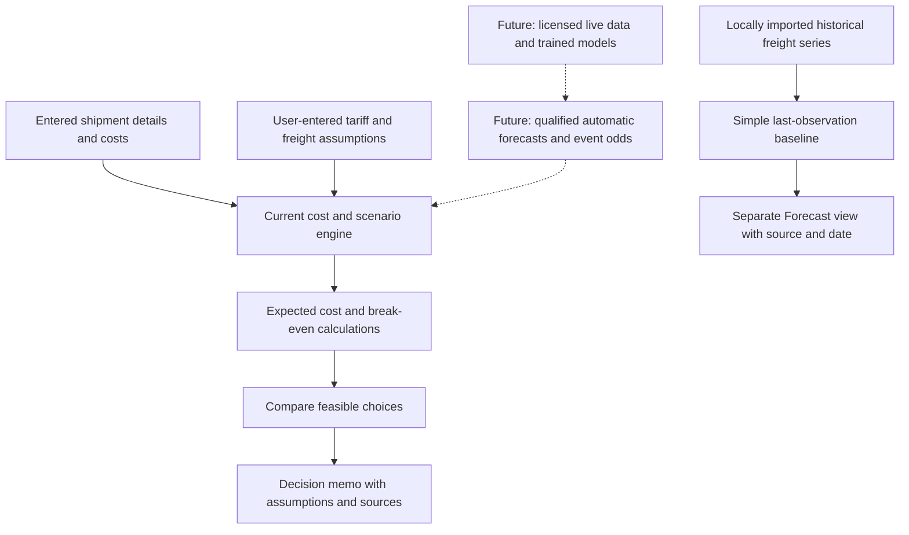
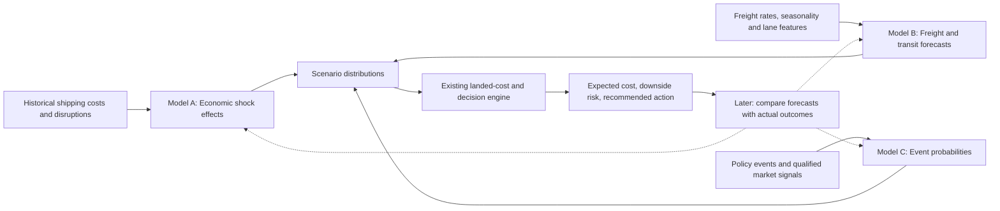

# Cost Current

**Know the cost. See the risk. Make the move.**

**Cost Current is a decision-support tool for small and midsize US importers.** It helps a business understand what a shipment is likely to cost, explore what tariff or freight disruptions could mean in dollars, and compare practical choices such as ordering earlier, waiting, changing routes, or qualifying another supplier.

**The long-term goal:** move beyond generic trade news and dashboards toward **evidence-backed, probability-aware recommendations for a specific importer's shipments**. Instead of only saying _“shipping risks are rising,”_ Cost Current aims to answer _“what could this cost my business, and what should I do about it?”_

> **Project status — October 16, 2026:** This repository contains a working **prototype**, not a production forecasting service. The shipment calculator, comparison workflow, interactive globe, CSV intake, and decision memos work with stated inputs. Intelligence can fetch observed USGS earthquake reports and NHC current-storm advisories with official forecast cones, then screen explicitly saved port/site coordinates; any cost requires user-entered disruption assumptions. A separate **Forecast** view can calculate a simple historical freight-rate baseline from a locally imported series. **Trained machine learning, live tariff/freight feeds, independently generated event probabilities, and validated customer savings are not yet implemented.**

**Repository:** [Sambhav255/cost_current](https://github.com/Sambhav255/cost_current)  
**Current focus:** Event-led intelligence in the local prototype—official observed earthquake or issued NHC cyclone cone → possible known-site overlap → conditional user scenario, alongside separate illustrative disruptions. The PortWatch maritime view is explicitly permission gated, with no actual transit series or model score. Live odds, calibrated models, and licensed feeds stay gated until authorized data and evidence exist.

In **Intelligence**, choose **Official observations** for the USGS rolling past-day earthquake feed, **Official forecasts** for current NHC advisories and linked forecast cones, **Illustrative** for fictional tariff/Suez cases, **Fictional test** for a deterministic quake near Northstar's fictional test port asset, or **Maritime research** to inspect the PortWatch access gate. Official data can be empty, stale or unavailable. To screen your own shipment, open its **Shipment & assumptions** tab and confirm a port or supplier-site name and coordinates. Earthquake distance and forecast-cone overlap are relevance screens, never damage, closure, delay or cost predictions. The user-entered delay/handling calculation is carried into a frozen What if? memo; the tariff/freight calculator remains a separate scenario. NHC requires the built-in `/api/nhc` same-origin endpoint, served by local Vite or the Vercel function. See the [source register](docs/DATA_SOURCE_REGISTER.md) and [unified integration plan](COST_CURRENT_UNIFIED_INTELLIGENCE_INTEGRATION_CODEX.md).

---

## At a glance

| The question                                 | Cost Current's answer                                                                                                                                                                                            |
| -------------------------------------------- | ---------------------------------------------------------------------------------------------------------------------------------------------------------------------------------------------------------------- |
| **Who is it for?**                           | US businesses that import products repeatedly, especially owners and purchasing, operations, or finance managers.                                                                                                |
| **What problem does it solve?**              | Tariffs, freight volatility, and delays make it difficult to know true landed cost or choose when and how to import.                                                                                             |
| **What does a user provide?**                | Shipment details, origin and destination, customs value, freight costs, dates, relevant duty assumptions, and possible alternatives.                                                                             |
| **What does the current prototype produce?** | Separate fictional scenarios, observed USGS reports and NHC forecast cones with known-site screening; conditional cost estimates, decision comparisons and a printable memo. PortWatch remains permission gated. |
| **What will the complete product add?**      | Official trade-rule context, usable freight history and forecasts, carefully mapped prediction-market signals, uncertainty estimates, alerts, backtests, and decision tracking.                                  |
| **What is the proposed business model?**     | Start with paid shipment analysis or pilots, then test subscription pricing. All prices below are **hypotheses**, not established offerings.                                                                     |

## The problem, in plain English

Imagine a furniture importer ordering its next container of products from China. The goods are worth $100,000, and the business has to decide whether to ship now or wait. Meanwhile:

- A possible policy change could increase duties.
- Ocean freight may become more expensive or less reliable.
- Ordering earlier could avoid some exposure, but it also ties up cash and creates inventory holding costs.
- The company's broker, freight forwarder, and spreadsheets may each answer a different part of the question.

The importer doesn't just need another article about tariffs. It needs a **shipment-specific financial comparison** using assumptions and evidence it can inspect and challenge.

This is the job Cost Current is designed to do.

## How it works



**Solid arrows show capabilities already built. Dashed arrows show the intended integration, not functionality that already exists.** The simple freight baseline is deliberately separate from the manual scenario engine: it does **not** automatically generate tariff-event probabilities or action rankings.

A typical customer workflow would be:

1. **Add a shipment.** Enter its product, supplier, route, value, existing duty and freight estimates, and arrival dates. Alternatively, import a supported CSV.
2. **Understand the starting cost.** Review goods, assumed duty, freight, insurance, brokerage, port, inland, and other charges. The tool distinguishes costs already included in a quote to avoid double counting.
3. **Assess uncertainty.** Use **What if?** for clearly labeled manual tariff and freight scenarios. Use **Forecast** to inspect an available, dated freight baseline; if usable observations are missing, the app says so.
4. **Compare decisions.** See the expected financial effect of waiting versus an eligible early order. Alternative routes and suppliers are compared only when the necessary inputs and constraints are supplied.
5. **Explain and share.** Inspect assumptions and the break-even point, then generate a one-page shipment decision memo.

### Example: Northstar Home Goods

The built-in **Northstar Home Goods** case is fictional, intended to show the economics of a decision rather than make a real-world prediction.

| Illustrative input or result                                       |       Amount |
| ------------------------------------------------------------------ | -----------: |
| Goods acquisition cost                                             |     $100,000 |
| Assumed existing duty (10% of customs value)                       |      $10,000 |
| Freight                                                            |       $7,000 |
| **Base landed cost**                                               | **$117,000** |
| Assumed chance of an additional 15-percentage-point tariff         |          40% |
| Assumed chance of a $3,000 freight surcharge                       |          20% |
| Expected extra tariff + freight exposure                           |       $6,600 |
| **Expected cost if waiting**                                       | **$123,600** |
| Expected cost if ordering early, including $3,500 incremental cost |     $121,100 |
| **Illustrative advantage of ordering early**                       |   **$2,500** |

In this example, the assumed extra tariff would cost **$15,000** if it occurs. Its probability-weighted cost is `40% × $15,000 = $6,000`. The assumed freight shock adds `20% × $3,000 = $600`. If an earlier arrival genuinely avoids the hypothetical extra tariff, the model compares the **$6,000 exposure avoided** against the **$3,500 cost of acting earlier**.

The break-even tariff probability is therefore approximately **23.33%**. Below that point, waiting is less costly under the example's assumptions. This is the value of the tool: not a single scary risk score, but an actionable financial threshold.

**Important:** Purchasing earlier does not automatically establish that different duty rules will apply. That depends on the actual legal effective dates, entry treatment, and transaction. The demo explicitly treats tariff avoidance as an assumption requiring confirmation.

## What is built today versus what is planned

| Capability                                | Current status         | What it means                                                                                                                                                    |
| ----------------------------------------- | ---------------------- | ---------------------------------------------------------------------------------------------------------------------------------------------------------------- |
| Interactive 3D globe and 2D fallback      | **Built**              | Select among illustrative trade-lane connections. These are not real vessel positions.                                                                           |
| USGS and NHC intelligence                 | **Built, bounded**     | Read current official earthquake reports and cyclone advisory cones; known-site matches are screening results, with no automatic operational or cost prediction. |
| PortWatch maritime research               | **Permission gated**   | Typed parser and synthetic/permissioned-vintage research script exist; no live series, real anomaly, or actual transit forecast is shown.                        |
| Shipment workspace and CSV import         | **Built**              | Edit shipments; locally preview and import validated CSV data.                                                                                                   |
| Itemized landed-cost ledger               | **Built**              | Calculate cost components without intentionally double counting included charges.                                                                                |
| **What if?** scenarios                    | **Built**              | Explore **user-entered** tariff and freight assumptions; not automatic probabilities.                                                                            |
| Compare wait / early order / alternatives | **Built, conditional** | Compare eligible options where costs, dates, and feasibility inputs are available.                                                                               |
| Break-even analysis and decision memo     | **Built**              | Explain sensitivity and export a reproducible, printable snapshot.                                                                                               |
| **Forecast** mode                         | **Early foundation**   | Generate a dated **last-observation** freight baseline from an explicitly imported local time series; show unavailable if data are insufficient or stale.        |
| Historical forecast evaluation            | **Basic foundation**   | Evaluate the simple baseline on eligible historical observations; no real-world model performance results are established.                                       |
| Live freight market feeds                 | **Not built**          | Requires usable providers, consistent quote definitions, and data rights.                                                                                        |
| Automatic tariff-event probabilities      | **Not built**          | Requires specific event definitions, relevant inputs, calibration, and historical outcomes.                                                                      |
| Kalshi / Polymarket integration           | **Not built here**     | Future read-only signals must be matched to an importer's real exposure; price alone is not a shipment probability.                                              |
| Trained ML or econometric forecasting     | **Not built**          | Planned research depends on legal, sufficiently complete historical data and measurable target definitions.                                                      |
| Accounts, shared workspaces, billing      | **Not built**          | Today the prototype stores its data locally in the browser.                                                                                                      |

The application currently supports four illustrative lanes: **Shanghai → Los Angeles, Haiphong → Savannah, Hamburg → Newark, and Shanghai → Rotterdam** (declared Suez corridor for the corridor demo). It limits the local workspace to 25 shipments. The built-in companies, rates, and disruption assumptions are fictional.

### A crucial distinction: Forecast vs. What if?

- **Forecast** is for system-generated outputs. At present, it can carry forward the latest eligible observed freight rate for a selected lane and a 28- or 56-day horizon, subject to data quality checks. This is a basic _naive baseline_, **not a trained ML prediction**. If there is no suitable series, it shows **unavailable** instead of making up a number. Tariff and freight-event odds are currently unavailable.
- **What if?** is for exploration. The user moves the tariff and freight probabilities and sees how the financial decision changes. The numbers are assumptions, not the system's beliefs about the future.

We intend for future, tested models to populate Forecast automatically. Users should still retain What if? to challenge assumptions and stress-test decisions. **Those two modes must never be confused.**

## Who could be a customer?

Our initial customer hypotheses focus on **repeat US importers with meaningful financial exposure and some ability to act**. The strongest customer isn't necessarily the largest; it's the one facing a recurring import decision where earlier orders, alternative suppliers, or route changes are genuinely possible.

| Candidate customer                               | Typical problem                                                             | Why they might pay                                                            |
| ------------------------------------------------ | --------------------------------------------------------------------------- | ----------------------------------------------------------------------------- |
| **Furniture and home-goods importers**           | Large container costs, long lead times, inventory commitments               | A single cost swing could change when or how they purchase.                   |
| **Consumer brands and ecommerce sellers**        | Thin margins, overseas suppliers, inventory arriving before seasonal demand | Understand landed margin and whether to move a purchase forward.              |
| **Apparel and footwear importers**               | Seasonal timing, changing landed cost, concentrated sourcing                | Compare landed-cost scenarios before placing purchase orders.                 |
| **Auto aftermarket and parts distributors**      | Repeat replenishment, many products and suppliers                           | Identify exposed products and prioritize purchasing decisions.                |
| **Small customs brokers and freight forwarders** | Clients asking, “What would this tariff or route change cost us?”           | A shareable, source-aware analysis memo could complement their advisory work. |

**Likely buyer:** owner, purchasing director, head of operations, or finance manager. **Likely daily user:** procurement or logistics staff. **Potential distribution partner:** a broker or forwarder who already has importer relationships.

**Who may be a poor fit:** companies that import only once, lack reliable shipment data, have no ability to change timing or sourcing, or whose supplier controls every relevant transport decision. These are target-market hypotheses to validate in customer interviews, not confirmed customer segments.

## Pricing: initial hypotheses, not live plans

No paid customers, conversion rates, or willingness-to-pay results have been established in the project documentation. The following illustrates potential packaging to test; **Cost Current is not currently selling these plans**.

| Possible offering                           | Illustrative price | Value being tested                                                              |
| ------------------------------------------- | -----------------: | ------------------------------------------------------------------------------- |
| **One-time shipment decision memo / pilot** |   **$99 per memo** | Will an importer pay for one useful, well-documented decision?                  |
| **Starter subscription**                    | **From $99/month** | Is there enough recurring value to justify continuous access?                   |
| **Growing importer plan**                   |      **Price TBD** | Multiple lanes, more shipments, shared reports, alerts, and stronger analytics. |
| **Broker / forwarder plan**                 | **Custom pricing** | Multiple client workspaces, branded reports, and repeat analysis.               |

The **$99 figures are test prices**, not researched market-clearing prices. A customer willing to buy a one-off memo is not automatically willing to subscribe monthly. Packaging must account for data-provider costs, refresh frequency, customer support, and how much measurable money the tool can help a customer save.

### What we need to validate commercially

We should speak to **5–10 importer or broker decision-makers**, bring an example of an actual upcoming shipment, and learn whether they:

1. Face tariff/freight uncertainty often enough to care.
2. Have the inputs needed for a cost comparison.
3. Can realistically act on an early-order, route, or supplier recommendation.
4. Trust the evidence and explanations enough to use the result.
5. Would pay for a pilot or recurring product instead of relying on a spreadsheet, broker, forwarder, or existing software.

## How the planned predictive engine could work

The product vision has **three complementary quantitative systems**, not one opaque AI score:



**Model A — Economic shock analysis.** Use event studies, regression and appropriate time-series methods to investigate how disruptions affect costs and delivery delays for particular lanes. Compare results with simple baselines; don't assume an event caused every price movement during its window.

**Model B — Freight and transit forecasting.** Start with last-observation and seasonal benchmarks. With usable history, evaluate SARIMAX and then gradient-boosting approaches such as **LightGBM or CatBoost**, including quantile forecasts for uncertainty. A statistical improvement must be measured out of sample before being claimed.

**Model C — Event likelihood and decision economics.** Define specific outcomes (for example, an applicable additional duty taking effect within a stated horizon) and estimate or calibrate their likelihood where evidence supports it. Combine that with estimated financial impacts, inventory constraints, and the existing transparent action-comparison engine. Monte Carlo simulation may be useful for richer correlated scenarios, but **simulation by itself is not a trained predictive model**.

### Where prediction markets fit

**Kalshi** and **Polymarket** could provide helpful signals for some well-defined policy, trade, or shipping events. They are **inputs to investigate**, not the central value proposition and not automatically equivalent to the probability of a tariff on a specific product.

Our other project, [Vigil](https://github.com/Sambhav255/Vigil), already explores public prediction-market, geopolitical, and macro feeds. We may reuse its integration patterns after reviewing API schemas and data rights. **No Vigil market connector has been integrated into Cost Current as of this README.** Future ingestion must check contract resolution rules, outcome identity, bid/ask and liquidity, timing, and relevance to a particular importer. Otherwise the correct output is **unknown**.

### Why accuracy and accountability matter

A visually compelling forecast is not valuable unless it improves decisions. We intend to evaluate forecasts against simple baselines using time-ordered, out-of-sample data; record forecast dates and source revisions; report errors and uncertainty; and eventually compare recommended actions with actual shipment outcomes. **There is no validated model-performance or realized-savings claim today.**

## Try the current prototype

The project is a local React + TypeScript application using Vite. It requires **Node.js 22.12+ (within Node 22)** and npm 10+. A pinned version is in `.nvmrc`.

```bash
git clone https://github.com/Sambhav255/cost_current.git
cd cost_current
npm ci
npm run dev
```

Open the local address shown in your terminal, normally **http://127.0.0.1:5173**. The basic demo does **not** need an API key, paid data subscription, account, or backend.

### Suggested five-minute walkthrough

1. Click **Explore supply-chain risks** on the welcome screen.
2. On **Intelligence**, open the China-origin home-goods tariff event and review **Northstar Home Goods** exposure (conditional extra duty **$15,000** if the event occurs—separate from probability-weighted portfolio totals on **My Exposure**).
3. Click **Explore options** to open **Decisions** in **What if?** mode. Confirm Northstar: **$123,600** wait versus **$121,100** early under the demo assumptions.
4. Switch to **Forecast** on the same shipment. Confirm automatic tariff and freight event odds stay **unavailable** rather than invented; optionally preview the clearly labeled fictional freight observation baseline.
5. Return to **What if?** and change the assumed tariff probability from **40% to 10%**. The preferred action switches from early ordering to waiting; the break-even point remains approximately **23.33%**.
6. Optional: **My Exposure** for portfolio totals, **Import shipments** for CSV preview and validation, and **Decision memo** to print or save the analysis.

**Note:** Any data you enter is saved in this browser's local storage. It is not synced to collaborators or other devices. Do not put confidential customer material in the prototype without first establishing appropriate security and retention controls.

### Development checks

```bash
npm run check       # Format, documentation links, lint, types, unit tests and build
npm run test:e2e    # Browser-based interaction tests (requires Playwright browser setup)
```

For browser setup, see the existing [engineering guide](docs/IMPLEMENTATION_PLAN.md). The repository's recent [GitHub Actions checks](https://github.com/Sambhav255/cost_current/actions) are passing as of this README review; future changes should keep them green.

## What we are building next

Our goal is **not** to add more dashboard cards before proving the predictive and economic value.

| Priority | Workstream                                             | Definition of progress                                                                                                                                                                                                                                                                           |
| -------- | ------------------------------------------------------ | ------------------------------------------------------------------------------------------------------------------------------------------------------------------------------------------------------------------------------------------------------------------------------------------------ |
| **1**    | **Complete event-to-decision intelligence loop**       | The **illustrative Intelligence slice** (curated demo events → exposure → **What if?**) is **delivered locally**. Next is **P2: authorized real signals** with exact IDs, timestamps, and failure states—not another UI-only redesign. Live feeds stay gated until rights and definitions exist. |
| **2**    | **Get one usable real freight dataset**                | Licensed or customer-authorized repeated observations for one lane, with units, date, quote scope, and usage rights documented.                                                                                                                                                                  |
| **3**    | **Test forecasting against a baseline**                | Time-ordered evaluation of last-observation and seasonal naive methods; only then test more complex models—still without claiming live market feeds in the prototype.                                                                                                                            |
| **4**    | **Prove customer value**                               | Interviews with actual importers/brokers and at least one real shipment decision or paid pilot test.                                                                                                                                                                                             |
| **5**    | **Add relevant event signals where evidence supports** | Exact policy/market event mapping, data-quality gates, unavailable states when unmatched, and calibrated probabilities only when sourcing and definitions are defensible.                                                                                                                        |
| **6**    | **Make the product repeatable**                        | Prospective decision journal, observed outcomes, vetted tariff coverage, trustworthy alerts, shared workspaces and integrations.                                                                                                                                                                 |

The initial focus is **one repeat importer segment and one defensible lane**, not a claim to predict every geopolitical shock on earth.

## Current limitations and safeguards

- **Not customs, legal, or investment advice.** A qualified professional must verify applicable duties, exemptions, country of origin, and entry treatment.
- **No live shipment tracking or real-time trade intelligence in this repo.** The globe draws illustrative connections, not vessel routes.
- **No live Kalshi or Polymarket probability feed.** Scenario sliders are user assumptions; Forecast event odds are unavailable.
- **No trained ML model or independently validated prediction accuracy yet.** The automated freight baseline carries forward the last eligible historical observation.
- **No guarantee of savings.** Recommendations follow entered assumptions and omit some potentially significant costs such as stockouts and financing schedules.
- **No commercial-grade security or licensed-data guarantee.** Data stays in local browser storage and the imported observation rights are declared by the person importing them, not verified by the software.

These are deliberate boundaries. A useful model should be able to explain when it **doesn't know**, rather than make a confident-sounding claim from inadequate data.

## For collaborators: where to start

If you're joining this project, the fastest way to understand it is to run the Northstar example, switch between Forecast and What if?, and inspect the decision memo. After that:

| Read this                                                            | For                                                                                  |
| -------------------------------------------------------------------- | ------------------------------------------------------------------------------------ |
| [Progress and actual implementation status](docs/PROGRESS.md)        | What's working, next priorities, and what remains unverified.                        |
| [Predictive intelligence plan](docs/PREDICTIVE_INTELLIGENCE_PLAN.md) | Active product direction and stage order (P2+).                                      |
| [Progress archive](docs/PROGRESS_ARCHIVE.md)                         | Dated checkpoints and superseded handoff history.                                    |
| [Forecast specification](docs/FORECASTS.md)                          | What the baseline does, data-quality rules, and why auto event odds are unavailable. |
| [Master product plan](COST_CURRENT_MASTER_BUILD_PLAN.md)             | Long-term scope, research models, customers, commercial hypotheses and major risks.  |
| [Master execution plan](docs/MASTER_EXECUTION_PLAN.md)               | Historical audit and intake/forecast foundation gates—not the live priority order.   |
| [CSV intake contract](docs/CSV_INTAKE.md)                            | Supported imports, validation, and source handling.                                  |
| [Engineering guide](docs/IMPLEMENTATION_PLAN.md)                     | Calculation invariants, architecture, tests, and safety boundaries.                  |

For **what to build next**, follow [Progress](docs/PROGRESS.md) and the [predictive intelligence plan](docs/PREDICTIVE_INTELLIGENCE_PLAN.md); treat [MASTER_EXECUTION_PLAN](docs/MASTER_EXECUTION_PLAN.md) as reference history for delivered intake and forecast foundation work.

### Suggested division of work

**Customer and business research:** Interview repeat importers; verify who owns purchasing decisions; test the paid memo offer; map direct and indirect alternatives.  
**Data and quantitative research:** Find a lawful repeated freight series; define units and forecast targets; run reproducible evaluations; document failed models as well as successful ones.  
**Product and engineering:** Maintain the functioning financial engine and interfaces; implement documented data contracts; preserve source labels and meaningful missing-data states.  
**Trade-domain validation:** Review a narrowly scoped real HTS/duty example and actual shipment constraints with a knowledgeable broker or adviser.

The important shared question is: **Can Cost Current make a recurring importer decision measurably better than the spreadsheet, broker advice, and software the customer already has?** That's what we need to prove.

---

**Cost Current** · Working prototype and research-stage venture · October 2026  
_Know the cost. See the risk. Make the move._
